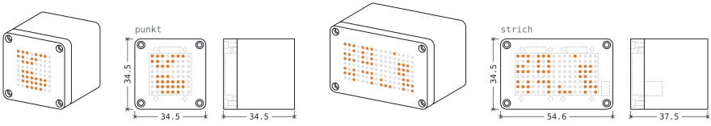
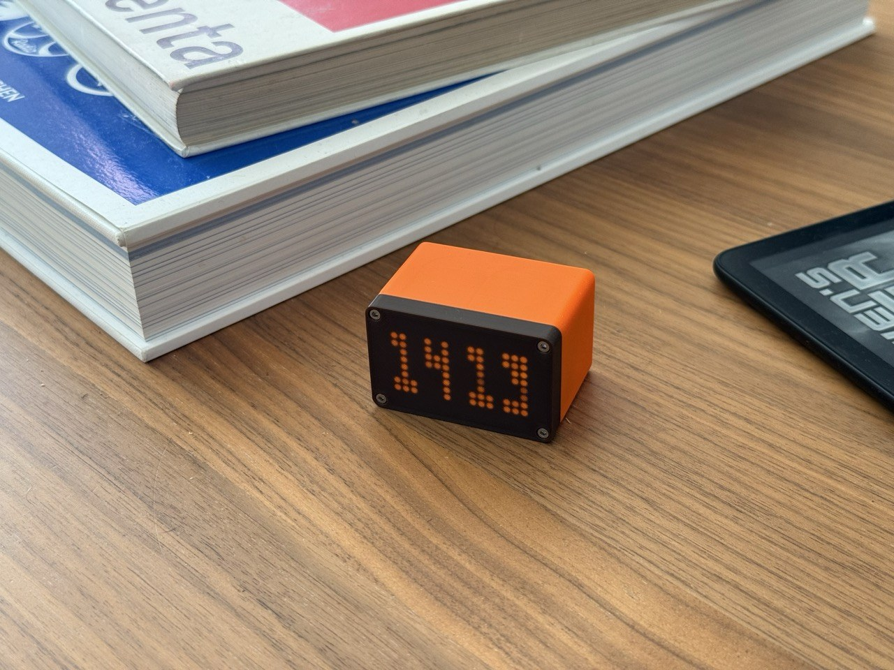

<picture>
  <source media="(prefers-color-scheme: dark)" srcset="docs/logo-dark.svg">
  
</picture>

# punkt/strich

<picture>
  <source media="(prefers-color-scheme: dark)" srcset="docs/blueprint/header-a-dark.svg">
  
</picture>

punkt is an LED matrix status light for Claude Code, built on an ESP32-S3
Super Mini. It sits next to the keyboard, shows what Claude is doing right now
and how full the context window and the 5 hour usage limit are, and it is
driven over a small HTTP API on the local network.

The firmware runs two boards. punkt is a single 8x8 matrix with one 5 euro
cent coin as its touch pad. strich spreads 16x8 over two matrices, the clock on
the left and Claude on the right, with two 2 euro cent coins under its top
wall and a 500 mAh cell that keeps it going for an hour or so unplugged, see
[strich](docs/usage.md#strich).


Claude Code fires hooks on every event of a session, a small shell script maps
each event to a state and POSTs it to the board over the LAN, and the board
plays the matching animation. The Claude Code status line runs a second script
that posts the context fill and the 5 hour usage on every render. Nothing
leaves the local network: the board talks to nothing but the machine running
Claude Code and an NTP server for the clock (`pool.ntp.org`, `time.nist.gov`).

## Features

- Twelve states, each with its own animation, and eleven animations to pick from
  for `working`
- Up to 8 Claude Code sessions share the one matrix, the most urgent one is on
  screen
- A coin on a wire is the only control needed day to day: tap, double tap,
  hold, and on strich two coins that also take a swipe
- The context window fill as a gauge on the bottom row, the 5 hour usage limit
  as a gauge filling the whole matrix
- A digital clock as the resting picture and the boot default, dimming itself
  the longer it rests
- Wi-Fi configured from a phone through a captive portal, and a phone friendly
  settings page on `punkt.local` with no external assets
- Firmware updates over the air
- A night window that switches the screen off on schedule, with deep sleep as
  an option, a double tap wakes it



## Security

The board has no authentication. Anything on the LAN can change its state, its
settings or its firmware through the HTTP API on port 80 and the OTA service on
port 3232, and a board without Wi-Fi credentials opens the open access point
`<name>-setup`. Keep it on a trusted network and do not expose either port to
the internet.

## Quick start

From the parts on the desk to a light that follows Claude Code.

### 1. Parts and wiring

The [bill of materials](docs/hardware.md#bill-of-materials) lists every part
for punkt and strich, and [Wiring](docs/hardware.md#wiring) shows how they
connect: four wires from the matrix backpack to the Super Mini, a coin on a
wire to GPIO4, and on strich a second matrix, a second coin and the LiPo. The
case files are `hardware/punkt_case.3mf` and `hardware/strich_case.3mf`, plus
an optional solder jig, `hardware/esp_solder_jig.3mf`. See
[docs/hardware.md](docs/hardware.md) for the case, the battery and the order
of assembly.

Flash the board before you connect the battery and close the case, with the
battery attached some USB-C ports no longer see the board, and the BOOT and
RESET buttons are hard to reach once the case is closed.

### 2. Requirements

- [PlatformIO Core](https://docs.platformio.org/en/latest/core/) (`pio`) on the
  PATH.
- `bash`, `jq` and `curl`, used by the Makefile targets, the hook scripts and
  the installer. `perl` is optional, the hook script uses it for millisecond
  timestamps.
- Claude Code, tested with 2.1.273. punkt needs its hooks and its status line,
  and the usage gauge needs the `rate_limits` status line fields, which Claude
  Code only sends for Pro and Max accounts.
- A 2.4 GHz Wi-Fi network. The ESP32-S3 has no 5 GHz radio.
- A data capable USB-C cable. A charge-only cable carries no data and the
  board will not show up.
- macOS or Linux, on Windows through WSL, see [Platforms](#platforms).

`make doctor` checks all of this on your machine, probes the board and the
installed hooks, and names what is missing together with the install hint:

```sh
make doctor
```

### 3. Build and flash

1. Connect the board over USB.
2. On the **first flash**, or whenever the board does not show up as a serial
   port, put it into download mode by hand: hold **BOOT**, tap **RESET** (or
   plug it in), release **BOOT**. Later flashes reset the board automatically.
3. Build and upload, then open the serial monitor:

```sh
make flash                  # punkt
make flash BOARD=strich     # strich
make monitor
```

PlatformIO finds the serial port on its own. When it picks the wrong one, on
macOS often the Bluetooth port, pass it: `make flash PORT=/dev/cu.usbmodemXXXX`,
the same for `make monitor`.

After a manual download-mode flash, tap **RESET** (or replug USB) once so the
new firmware starts and the serial port reappears.

At 115200 baud a healthy boot after power-on passes these lines, among the
radio and touch ones. A boot the serial monitor, a flash or a crash caused
logs its own reason and `punkt: boot not counted` in place of the count, see
[Reset reasons](docs/technical.md#reset-reasons):

```
punkt: reset reason poweron
punkt: boot 1/3 in window
punkt: matrix ok, version 1.0.0
punkt: state loading <- off (boot)
punkt: wifi connected 192.168.1.10
punkt: http listening on port 80
punkt: state idle <- loading (wifi)
```

If the matrix is missing or miswired, the board logs
`punkt: matrix not found at 0x70 on SDA=8 SCL=9, retrying` every 2 seconds
until it succeeds. When the upload fails, see
[Troubleshooting](docs/usage.md#troubleshooting).

### 4. First boot and Wi-Fi

A freshly flashed board has no Wi-Fi credentials. After the boot log it opens
an open access point named **`punkt-setup`**, **`strich-setup`** on strich.
Join it from a phone or laptop, the captive portal opens by itself (otherwise
browse to `http://192.168.4.1`), pick your network and enter its password.
While all of this runs the matrix shows the **`wifi-search`** picture, the
Wi-Fi symbol whose arcs light up one after another.

The save lights the whole matrix once to acknowledge it, then the board
restarts and comes up connected, and the state switches to **idle**. If the
serial monitor is open, the assigned address is logged as
`punkt: wifi connected <ip>`.

After connecting, the board publishes itself over mDNS as **`punkt.local`**
(**`strich.local`** on strich) and serves the
[settings page](docs/usage.md#settings-page) and the API on port 80. Both
names follow the `name` setting: a renamed board answers as `<name>.local` and
opens `<name>-setup` from its next restart on. Why the save restarts the
board, and what the matrix does when the link goes away later, is in
[The Wi-Fi link](docs/technical.md#the-wi-fi-link).

### 5. Claude Code hooks

With the board on the network, install the Claude Code integration:

```sh
make hooks-install                    # punkt.local
make hooks-install HOST=strich.local  # strich
```

It copies `claude/punkt.sh` and `claude/punkt-statusline.sh` to
`~/.claude/hooks/` and merges the hook registrations from `claude/hooks.json`
into `~/.claude/settings.json`. What that does to your settings:

- Your settings file is copied to `settings.json.bak` before anything is
  written, as long as it holds no punkt hooks yet. A reinstall leaves the
  backup alone, so it always holds the last version without punkt, and the
  output says which of the two happened. `make hooks-uninstall` writes no
  backup and leaves the existing one in place.
- A status line that runs `~/.claude/statusline-command.sh` is wrapped, not
  replaced: punkt's script posts the percentages and then passes that script's
  output and exit code through unchanged, and `make hooks-uninstall` puts the
  recorded previous value back. Any other status line is left alone, with a
  note that the context gauge needs `punkt-statusline.sh`.
- A second install changes nothing. Other hooks and settings stay untouched.

`make hooks-uninstall` removes the hooks, the status line and the copied
scripts again. `make hooks-diff` prints what an install would change without
writing anything, which is also the way to check an installation.

`hooks-install` writes the user settings, so the hooks follow every session. To
have the light track only one project, run `make hooks-uninstall`, copy the
scripts with `install -m 755 claude/punkt.sh claude/punkt-statusline.sh
~/.claude/hooks/` and paste the `hooks` block of `claude/hooks.json` into that
project's `.claude/settings.json`. Several boards, several Claude directories
and one directory posting to several boards are covered in
[usage.md](docs/usage.md#several-boards-and-claude-directories).

Start Claude Code and the matrix follows it. What each picture means is in
[usage.md](docs/usage.md#what-the-matrix-shows).

### 6. OTA updates

The firmware runs ArduinoOTA under the board name (port 3232, no password). It
is started on the first successful Wi-Fi connection, so OTA is only available
once the board is on the network.

```sh
make ota                  # punkt.local
make ota BOARD=strich     # strich.local
make ota HOST=192.168.1.10
```

While the image is received the matrix fills along the `ota` spiral, one pixel
per 64th of the image (on strich it spans the whole 16x8 canvas), see
[Link and update pictures](docs/technical.md#link-and-update-pictures). The
board reboots into the new firmware on its own. A failed transfer is logged as
`punkt: ota error <reason>`, the spiral clears, the old firmware keeps running
and the matrix returns to what the sessions show.

espota, the uploader PlatformIO uses, cannot resolve `.local` names itself
(`Host punkt.local Not Found`), so `make ota` resolves `HOST` to its IPv4
address first, through `dscacheutil` on macOS, `getent` on Linux or
`avahi-resolve`, and takes an IPv4 address as is. Without the Makefile:

```sh
pio run -e punkt-ota -t upload --upload-port 192.168.1.10
```

Boards flashed with a pre-1.0 build keep stale settings, do a
[factory reset](docs/usage.md#factory-reset) after updating.

## Platforms

### macOS

Everything works as described. The board shows up as `/dev/cu.usbmodem*`.
When PlatformIO picks the Bluetooth port instead, pass
`PORT=/dev/cu.usbmodemXXXX` to `make flash`, `make monitor` and
`make flash-jtag`.

### Linux

- The board shows up as `/dev/ttyACM*`. Serial access needs your user in the
  `dialout` group (`uucp` on Arch), log out and back in after adding it, or a
  udev rule for `/dev/ttyACM*`, for example the
  [PlatformIO udev rules](https://docs.platformio.org/en/latest/core/installation/udev-rules.html).
- `.local` names need `avahi-daemon` and `libnss-mdns`. Without them pass the
  address to every target, `make status HOST=192.168.1.10`, and install the
  hooks with `HOST=<ip>`.
- The first flash may need download mode: hold **BOOT**, tap **RESET** or plug
  the board in, release **BOOT**.
- `make doctor` checks the mDNS resolver and the serial ports as well.

### Windows

The Makefile, the hook scripts and the installer need bash and do not run
natively on Windows. Use [WSL](https://learn.microsoft.com/windows/wsl/) with
Claude Code running inside it, and follow the Linux notes. USB passthrough to
WSL needs [usbipd-win](https://github.com/dorssel/usbipd-win). Alternatively
flash from Windows with PlatformIO directly
(`pio run -e punkt -t upload`, `-e strich` for strich) and use WSL only for the
hooks. When `.local` names do not resolve inside WSL, pass `HOST=<ip>`.

## Prebuilt firmware

The CI build of every push uploads `firmware.bin` for each board,
`punkt/firmware.bin` and `strich/firmware.bin` in the `firmware` artifact, and
each GitHub release attaches the same two files. `firmware.bin` is the app image alone,
without the bootloader and the partition table, so it updates a board that
already runs this firmware over the air. The first flash goes through
PlatformIO, see [Build and flash](#3-build-and-flash).

To update over the air with a downloaded image, pick the file for your board
and hand it to espota, which PlatformIO installs with the ESP32 framework:

```sh
python3 ~/.platformio/packages/framework-arduinoespressif32/tools/espota.py \
  -i 192.168.1.10 -p 3232 -f firmware.bin
```

## Documentation

- [docs/hardware.md](docs/hardware.md): parts, wiring, coins, battery, case
  and assembly
- [docs/usage.md](docs/usage.md): what the matrix shows, the coins, views,
  settings page, night sleep, auto dim, factory reset, troubleshooting and
  known limitations
- [docs/reference.md](docs/reference.md): HTTP API, settings, event mapping,
  serial commands, make targets and the hook scripts
- [docs/technical.md](docs/technical.md): the firmware behaviour in depth,
  every timing, log line and rule behind the pictures
- [CONTRIBUTING.md](CONTRIBUTING.md): project layout, build and test
  commands, code conventions, adding an animation and the hook script
  internals

## License

Everything in this repository, the code, the case models, the wiring diagrams
and the pictures, is under
[CC BY-NC 4.0](https://creativecommons.org/licenses/by-nc/4.0/), see
[LICENSE](LICENSE). Build it, change it and share it, with credit, but do not
sell it or anything made from it.
