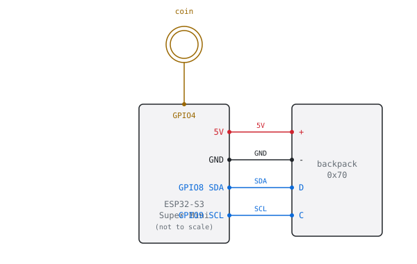
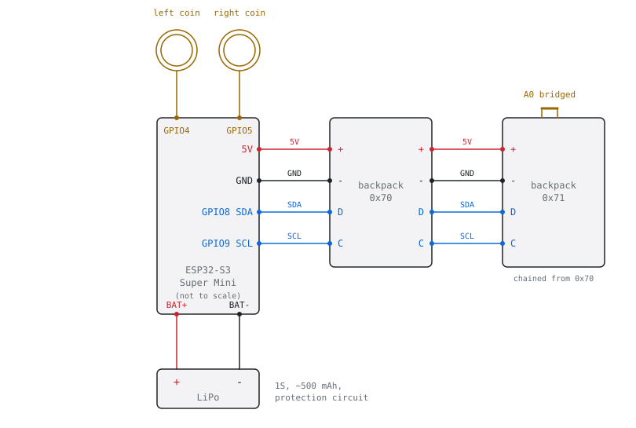

# Hardware

This page covers everything you need to build a punkt or a strich: the parts,
the wiring, the case, the battery and the order to assemble it in. Building and
flashing the firmware is in the [README](../README.md), day to day use in
[usage](usage.md).

- **punkt**: one 8x8 matrix, one coin touch pad, powered over USB.
- **strich**: two 8x8 matrices side by side (16x8), two coin touch pads and a
  single-cell LiPo of about 500 mAh.

Both run the same firmware on the same board. Only the parts list and the
wiring differ.

## Table of contents

- [Bill of materials](#bill-of-materials)
- [Wiring](#wiring)
- [Touch coins](#touch-coins)
- [Battery](#battery)
- [Printing the case](#printing-the-case)
- [Assembly](#assembly)
- [License](#license)

## Bill of materials

| Part | punkt | strich | What matters when buying |
|------|:-----:|:------:|--------------------------|
| ESP32-S3 Super Mini | 1 | 1 | The 4 MB flash variant, as sold by vipitec, which is the board the author built with. Boards from other sellers look alike but may differ in the power path (charger, battery pads, on-board divider), and the power facts in [Battery](#battery) come from the Tinytronics schematic, which matched the measurements. The board must have the USB-C port, the BAT pads and the onboard charger |
| Adafruit Mini 0.8" 8x8 LED matrix with HT16K33 backpack | 1 | 2 | Single colour, the colour is your choice. Buy the I2C backpack version with the HT16K33 driver. Buy both in the same colour so the halves match |
| Coin | 1 | 2 | punkt uses one 5 euro cent coin (about 21 mm). strich uses two 2 euro cent coins, which are smaller and fit under its top wall. Outside the euro area any similar copper plated coin, a copper disc or a flat copper washer works. A different size changes the touch reading, the `touchTrigger` setting tunes it, see [Touch coins](#touch-coins) |
| Thin stranded wire | 5 pieces | 10 pieces | Silicone insulated, about 28 to 30 AWG, flexible, easy to solder. Four wires join the matrix to the board and one goes to the coin, about 10 cm each. strich needs four more for the second matrix and one for the second coin |
| LiPo cell, single cell (1S) | none | 1 | About 500 mAh, 3.7 V, size 902030, with its own protection circuit (the board has none) and a JST-PH 2.0 plug, see [Battery](#battery). It has to fit the case, check the case drawings before you order |
| Data capable USB-C cable | 1 | 1 | A charge only cable carries no data and the board will not show up on your computer |
| M2 brass heat-set insert | 4 | 4 | Per case. They sit in the case and take the front screws. Length _to be added_ |
| M2 screw, large flat head (wafer or flat pan head), front | 4 | 4 | Hold the screen plate to the inserts in the case. Length _to be added_ |
| M2 screw, inner | 4 | 4 | Hold the matrix (on strich, the matrices) to the screen face from the inside. Length _to be added_ |
| Solder jig for the Super Mini (optional) | 1 | 1 | Printed from `hardware/esp_solder_jig.3mf`, see [Printing the case](#printing-the-case). It holds the board steady while you solder wires to its pads |

The A0 address on the right-hand backpack of strich is set with a blob of
solder, you do not buy anything for it. A 2.54 mm pin header is only needed if
your backpacks come without one and you want to plug the wires in rather than
solder them to the pads.

Tools:

- Soldering iron, solder and flux, a fine tip helps. The iron also sets the heat-set inserts in the case.
- Wire cutters and strippers.
- A multimeter, for the polarity check on the battery.
- A 3D printer for the case, see [Printing the case](#printing-the-case).

## Wiring

The diagrams are schematic and not to scale. They are not drawn after the
physical pad layout of the Super Mini, which differs between sellers: read the
labels on the silkscreen of your own board and match them to the pad names
here.

### punkt

| Matrix backpack | ESP32-S3 Super Mini |
|-----------------|---------------------|
| VCC / +         | 5V                  |
| GND / -         | GND                 |
| SDA / D         | GPIO8               |
| SCL / C         | GPIO9               |

The coin goes to GPIO4 and nothing else is connected to it.

<picture>
  <source media="(prefers-color-scheme: dark)" srcset="wiring/punkt-dark.svg">
  
</picture>

The backpack has its own pull-ups, so no external resistors are needed. The
onboard WS2812 on GPIO48 is not used, the firmware keeps it dark.

### strich

| Part | Connects to |
|------|-------------|
| Backpack 1 (left, `0x70`) VCC / +, GND / -, SDA / D, SCL / C | 5V, GND, GPIO8, GPIO9 |
| Backpack 2 (right, `0x71`) VCC / +, GND / -, SDA / D, SCL / C | The same four pads, chained from backpack 1 |
| Left coin | GPIO4 (touch channel T4) |
| Right coin | GPIO5 (touch channel T5) |
| LiPo + and - | BAT+ and BAT- pads of the Super Mini |

Bridge the A0 pad on the right-hand backpack with solder to set its address to
`0x71`. The left one stays at `0x70`. Mount both the same way round. The
`0x70` matrix carries the clock half and the `0x71` one the animations.

GPIO3 senses VBUS through a divider that is already on the Super Mini, nothing
to wire.

<picture>
  <source media="(prefers-color-scheme: dark)" srcset="wiring/strich-dark.svg">
  
</picture>

Wire up the matrices and coins first and the battery last, see
[Assembly](#assembly).

## Touch coins

A coin is the capacitive touch pad. The coin is the contact surface and a wire
joins it to the pin: GPIO4 on punkt, GPIO4 (left) and GPIO5 (right) on strich.
The touch gestures themselves are described in
[The coin and the BOOT button](usage.md#the-coin-and-the-boot-button) and
[Two coins on strich](usage.md#two-coins-on-strich).

Attaching:

1. Solder a wire of about 10 cm to the coin, or glue it down with conductive
   glue or copper tape. Scratch or sand the spot first, plated coins take
   solder poorly. Keep the heat short.
2. Solder the other end to the GPIO pad. Do this before you power the board,
   see the warning below.
3. Route the wire away from the matrix and from the power lines. A wire that
   runs along them picks up noise and raises the resting reading.
4. Fix the coin where the case holds it. On strich the coins sit under the top
   wall, one over the left matrix and one over the right, so a finger on the
   top of the case reaches them. On punkt the coin sits under the top wall
   over the matrix in the same way. Keep the coin flat against the underside of
   the wall, with no air gap and no metal behind it.

Tuning:

- The coin is read through the plastic of the case, a thin top wall works
  best. A thicker wall or a smaller disc lowers the signal.
- `touchTrigger` is the percentage above the resting reading that counts as a
  touch. The default is 25 on punkt and 15 on strich. Lower it if touches do
  not register, raise it if the board reacts without a finger. It is set on
  the settings page.
- `debugTouch` streams the live readings of the coin over the serial port, so
  you can see the resting level and what a finger adds.
- Attach or change a wire before power-on. A wire attached while the board
  runs raises the resting reading in one step, which reads as a touch that
  never releases and runs into the factory reset. If you must change it live,
  raise `touchTrigger` first.
- Handle the case as it will sit on the desk when you tune. Moving a cable or
  a hand near the board changes the readings.

How the firmware follows the baseline is in [Touch](technical.md#touch) and
[Two coins](technical.md#two-coins).

## Battery

This section applies to strich only. punkt has no battery.

What the board does:

- The Super Mini charges the cell from USB through its onboard TP4054 charger
  at about 100 mA (10k PROG resistor). A full charge from empty takes several
  hours. A BOOST jumper on some boards raises this to 300 mA, leave it open for
  a 500 mAh cell. This is from the Tinytronics ESP32-S3 SuperMini schematic,
  boards from other sellers may differ.
- The charge LED on the board blinks at about 1 Hz while no battery is
  attached. That is the charger and not the firmware.
- Once USB is gone, the cell feeds VBUS through a diode on the board, with a
  measured drop of about 0.7 to 0.85 V under load. On battery the 5V pad
  carries roughly the cell voltage minus 0.8 V, about 3.3 V with a full cell.
  The matrices still run on that, a bit dimmer.
- GPIO3 reads VBUS through the on-board divider. Above about 4.5 V on VBUS the
  firmware sees USB, below it the board is on battery and the same reading
  gives a rough charge estimate. The percentage is only an estimate, mapped
  along a curve measured on one cell.

Safety:

- The board has no protection IC. Use a cell with its own protection circuit
  (overcharge, over-discharge, short), a small board on the cell's leads. Never
  use a bare cell.
- Check the polarity before you solder. Measure the cell leads with a
  multimeter and match them to the BAT+ and BAT- pads of the board. JST-PH
  plugs from different sellers are wired differently, so never trust the plug
  or the wire colours alone.
- Solder the cell last, with the board unpowered, and keep both leads apart
  while the iron is on the pads.
- Do not short the leads, do not pierce or bend the cell, and keep it clear of
  heat. Leave room for it in the case so nothing presses on it.
- Stop using a cell that swells, gets hot while charging, or smells.

USB chargers and ports:

- With the battery attached, the battery back-feeds VBUS. Some computers' own
  USB-C ports then do not power or enumerate the board, and a USB-C charger may
  refuse it the same way. A USB hub works.
  To use it on a Mac through a dock or hub, connect the dock to the Mac first
  and strich to the dock afterwards. This is listed under
  [Known limitations](usage.md#known-limitations).
- Flash before you connect the battery, or flash through a hub.

Runtime and low battery:

- **Runtime:** about an hour unplugged, depending on brightness.
- A dot blinks in the bottom right corner of the left matrix below 15 percent.
  On battery the board also goes to deep sleep after a while without use.
  Both are described in
  [Battery](usage.md#battery) and
  [Battery sleep](technical.md#battery-sleep).

## Printing the case

**Case files:** _to be added_

- [`hardware/punkt_case.3mf`](../hardware/punkt_case.3mf): the punkt case, with
  the bodies "Case" and "Screen".
- [`hardware/strich_case.3mf`](../hardware/strich_case.3mf): the strich case,
  with the bodies "Strich case" and "Strich screen".
- [`hardware/esp_solder_jig.3mf`](../hardware/esp_solder_jig.3mf): a jig that
  holds the ESP32-S3 Super Mini steady while you solder wires to its pads.
  Optional, useful for both variants.

All files are 3MF in millimetres, exported from Fusion. Each case prints as two
parts: the case and the screen plate. The screen plate is the front of the
device.

**Suggested print settings:** _to be added_ (material, layer height, wall
count, infill, supports, orientation)

**Photo of the printed parts:** _to be added_

The top wall has to stay thin enough for the touch coins to read through it,
see [Touch coins](#touch-coins).

## Assembly

Do the steps in this order. Flash before the case is closed, since the
board is hard to reach afterwards.

1. **Flash the firmware over USB.** Connect the Super Mini with a data
   capable cable and follow
   [Build and flash](../README.md#3-build-and-flash). Do this on the bare board, before any
   wire is soldered to it. Later updates run over the air.
2. **Set the heat-set inserts.** Press the 4 M2 brass inserts into the case
   with the soldering iron, straight and flush. Let them cool before you
   screw into them.
   **Photo: _to be added_**
3. **Prepare the backpacks.** Solder a header or wires to the four pads (+, -,
   D, C) of each backpack. For strich, bridge the A0 pad on the right-hand one
   with a blob of solder.
   **Photo: _to be added_**
4. **Solder the matrix wires.** Optionally put the Super Mini in the solder
   jig first, it holds the board steady. Join + to 5V, - to GND, D to GPIO8 and C to
   GPIO9. On strich, chain the second backpack from the first and mount both
   the same way round.
   **Photo: _to be added_**
5. **Attach the coins.** Wire of about 10 cm from each coin to GPIO4, and on
   strich to GPIO5 for the right one. See [Touch coins](#touch-coins).
   **Photo: _to be added_**
6. **Test before the battery.** Power the board over USB and check the first
   boot: the matrix lights and the board shows up for Wi-Fi setup, see
   [First boot and Wi-Fi](../README.md#4-first-boot-and-wi-fi).
   Touch each coin and see it react. On strich, check both halves show a
   picture.
7. **Connect the battery last (strich).** Check the polarity with a
   multimeter, then solder the cell to BAT+ and BAT-, see
   [Battery](#battery). The block on the back of the screen plate holds the
   cell in place once the case is closed. Unplug USB and see that the board keeps running, then
   plug it in again.
   **Photo: _to be added_**
8. **Close the case.** Screw the matrix (on strich, both matrices) to the
   inside of the screen plate with the 4 inner M2 screws, press the coins
   against the underside of the top wall, route the wires clear of the
   matrices, tuck the battery in without pressure and close the case with the
   4 front M2 screws into the inserts.
   **Photo: _to be added_**

If something does not work, see
[Troubleshooting](usage.md#troubleshooting).

## License

The case models, the wiring diagrams and the code are under CC BY-NC 4.0, see
[LICENSE](../LICENSE).
