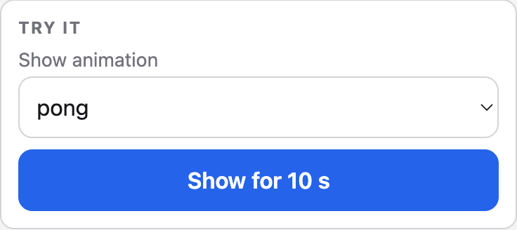

# Reference

Everything you look up while driving the board: the HTTP API, the settings,
how Claude Code events map to states, the serial console, the make targets
and the hook scripts. What the pictures mean and how the coins work is in
[usage.md](usage.md), the exact timings and log lines in
[technical.md](technical.md).

- [HTTP API](#http-api)
- [Settings](#settings)
- [Event mapping](#event-mapping)
- [Serial debug commands](#serial-debug-commands)
- [Make targets](#make-targets)
- [The hook scripts](#the-hook-scripts)

## HTTP API

Port 80, everything is JSON. The examples use `punkt.local`, a strich answers
as `strich.local`, and either can be replaced by the IP address.

| Method | Path | Body | Response |
|--------|------|------|----------|
| `GET` | `/` | | Settings page, `text/html` |
| `GET` | `/state` | | State, view, animation on the matrix, brightness ceiling in effect and whether it is dimmed, why the screen is off, uptime, the reason of the last reset, name, `board` (the product, `punkt` or `strich`), IP, RSSI, version, power save, night sleep, night off, temperature, context, usage, sessions with their state and activity, touch, on strich the power supply |
| `POST` | `/state` | `{"state":"<name>","session":"<id>","activity":"<name>","animation":"<name>","ts":<ms>}` | `{"state":"<name>"}`, plus `"session"` and `"activity"` when they were given |
| `POST` | `/context` | `{"percent":<0-100>}` | `{"percent":<0-100>}` |
| `POST` | `/usage` | `{"percent":<0-100>}` | `{"percent":<0-100>}` |
| `POST` | `/view` | `{"view":"clock"\|"normal"\|"usage"\|"off"\|"toggle"}` | `{"view":"<name>"}`, 409 when refused |
| `GET` | `/preview` | | List of every animation name the board owns |
| `POST` | `/preview` | `{"animation":"<name>"}` | `{"animation":"<name>"}`, plays it for 10 s, 400 for an unknown name |
| `GET` | `/settings` | | Full settings object |
| `POST` | `/settings` | Any subset of the settings keys | Full settings object |
| `GET` | `/cities` | | The cities the `city` setting accepts, with region and coordinates |
| `POST` | `/reboot` | | `{"ok":true}`, then restarts |
| `POST` | `/forget-wifi` | | `{"ok":true}`, then erases credentials and restarts |

Every POST body must be sent with `Content-Type: application/json`. Without it
the request never reaches the JSON handler and is answered with a 400 and
`{"error":"body must be JSON, send Content-Type: application/json"}`.

A body that is missing or is not valid JSON is answered with a 400 and an empty
body, one over 512 bytes with a 413 and an empty body. Both come from the JSON
handler before any validation runs.

Validation errors are `{"error":"<message>"}` with status 400, unknown paths
return `{"error":"not found"}` with status 404. `POST /state` and `POST /settings`
answer `{"error":"busy, retry"}` with status 503 when the queue to the main
loop is full, which takes more requests in one millisecond than the queue
holds. `POST /view` answers `{"error":"no session"}` with status 409 when the
board refuses the change.

### `GET /state`

```sh
curl -4 http://punkt.local/state
```

```json
{"state":"working","view":"clock","animation":"clock","uptimeS":123,"reset":"poweron","name":"punkt","board":"punkt","ip":"192.168.1.10","rssi":-61,"version":"1.0.0","powerSave":true,"nightSleep":false,"nightOff":false,"brightness":8,"dimmed":false,"offReason":"none","temperatureC":48.3,"context":42,"contextStale":false,"contextAgeS":12,"usage":17,"usageStale":false,"usageAgeS":12,"sessions":[{"id":"abc123","state":"working","activity":"editing"}],"touch":{"raw":166089,"baseline":166007,"touched":false,"proximity":0,"lastEvent":"tap","lastEventAgeS":40,"restarts":0}}
```

`contextAgeS`, `usageAgeS` and `touch.lastEventAgeS` are `null` while nothing
was received or reported yet, `temperatureC` is `null` until the first sample.
`touch.lastEvent` is `none`, `tap`, `hold` or `double-tap`, `touch.proximity`
is the hover level 0 to 3, 3 on contact only, and `touch.restarts` counts the
sensor restarts of the freeze guard, see [Touch](technical.md#touch). On
strich `touch` is the left coin and `touchRight` carries the same fields for
the right coin. On strich `power` carries `usb`, `true` while USB power is present, and `vbusMv`, the
VBUS voltage in millivolts (the cell voltage less a diode drop of 0.7 to 0.85 V on battery), sampled every 200 ms.
On battery it also carries `percent`, the rough charge estimate 0 to 100 the `battery` view shows,
missing on USB and before the first battery sample.
`reset` is the reason of the last reset, `poweron`, `external`, `software`,
`panic`, `int-wdt`, `task-wdt`, `wdt`, `deepsleep`, `brownout`, `sdio`, `usb`
or `unknown`, see [Reset reasons](technical.md#reset-reasons).
Every session entry carries its `activity`, `thinking` for a
session that sent none.
`animation` is the
animation on the matrix, so it reads `wifi-search`, `wifi-lost`, `ota` or
`reset` while one of the
[link and update pictures](technical.md#link-and-update-pictures) shows,
or the name of a running [preview](#post-preview). `brightness` is the ceiling
in effect, the `brightness` setting while [auto dim](usage.md#auto-dim) is off and the
level the sun's elevation maps to while it is on. `dimmed` is `true` while the
resting clock has capped it further, and `offReason` is `manual`, `timeout` or
`schedule` while the screen is off, `none` otherwise, see
[the display cascade](technical.md#display-cascade).

### `POST /state`

Accepts `off`, `loading`, `idle`, `working`, `attention`, `done`, `error`,
`waiting`, `compacting`, `limit`, `unread` and `glitch`. The request is queued
and applied on the board's next cycle, which also resets that session's
watchdog.

`session` is optional, at most 32 characters, and defaults to the anonymous
session when omitted.

`activity` is optional and only takes effect with `state: "working"`. It
accepts `thinking`, `reading`, `editing`, `shell`, `delegating` and `mcp`, and
a `working` request without it works in `thinking`. The board picks the
animation for the activity from the `animations` setting, so a caller names an
activity rather than an animation.

`animation` is optional as well and is the explicit override: with
`state: "working"` it beats the activity's animation for that one session; it
accepts `tetris`, `life`, `knight`, `orbit`, `code`, `rain`, `scan`, `pipes`,
`pointer`, `pong` or `terminal`. Both fields are kept with the session only
while it stays `working`: a `glitch` keeps them too and hands them back once
it ends, every other state resets them, and the next `working` request has to
carry them again. The hook script does
that for the activity: it remembers the last one per session and repeats it
for a tool without an activity of its own. Posting `working` without `animation` clears any
earlier override for that session and falls back to the activity's animation.

`ts` is optional, the sender's clock in milliseconds when the request was
made. The board keeps the newest `ts` it applied per session and drops a
request carrying an older one, since it was overtaken on the way, logged as
`punkt: stale <state> dropped (api <session>)`. A `ts` more than 10 s older
than the last one is applied anyway, only a sender clock that jumped back
explains such a gap. Requests without `ts` always apply; the `punkt.sh` hook
script always sends it.

```sh
curl -4 -X POST http://punkt.local/state \
  -H 'Content-Type: application/json' \
  -d '{"state":"working","session":"abc123","activity":"editing"}'
```

```json
{"state":"working","session":"abc123","activity":"editing"}
```

Errors: `{"error":"unknown state"}` for an unrecognised `state`,
`{"error":"session must be at most 32 characters"}` for an oversized
`session`,
`{"error":"activity must be thinking, reading, editing, shell, delegating or mcp"}`
for an unrecognised `activity`,
`{"error":"animation must be tetris, life, knight, orbit, code, rain, scan, pipes, pointer, pong or terminal"}`
for an unrecognised `animation`, and
`{"error":"ts must be a whole number of milliseconds"}` for a negative or
fractional `ts`.

### `POST /context`

Reports how full the context window is, machine-wide rather than per session,
shown as described under [Views and gauges](usage.md#views-and-gauges).

```sh
curl -4 -X POST http://punkt.local/context \
  -H 'Content-Type: application/json' \
  -d '{"percent":42}'
```

```json
{"percent":42}
```

`percent` must be a whole number between 0 and 100, anything else returns
`{"error":"percent must be a whole number between 0 and 100"}`.

### `POST /usage`

Reports the share of the 5 hour usage limit that is spent, stored the same way.

```sh
curl -4 -X POST http://punkt.local/usage \
  -H 'Content-Type: application/json' \
  -d '{"percent":17}'
```

```json
{"percent":17}
```

`percent` is checked the same way as on `/context`.

### `POST /view`

Switches the view the way the touch does, see [Views](technical.md#views).
`toggle` advances the tap cycle `clock`, `normal`, `usage` and back to `clock`,
and changes nothing while the view is `off`. Entering or leaving `off` is the
one change that needs no session, every other one is refused without one. On
strich `battery` is accepted as well, entering it and leaving it for `clock`
need no session either and `toggle` returns from it to `clock`; punkt answers
`battery` like an unknown view.

```sh
curl -4 -X POST http://punkt.local/view \
  -H 'Content-Type: application/json' \
  -d '{"view":"usage"}'
```

```json
{"view":"usage"}
```

Anything else returns
`{"error":"view must be clock, normal, usage, off or toggle"}`, with `battery`
in the list on strich. A change the
board refuses because no session is connected returns `{"error":"no session"}`
with status 409 and leaves the matrix alone, the glitch flash is the touch's
answer only. Asking for the view the board already shows is accepted.

### `GET /preview`

Lists every animation the board owns, in a fixed order the settings page's
"Try it" dropdown uses to fill itself.

```sh
curl -4 http://punkt.local/preview
```

```json
{"animations":["off","orbit","clock","tetris","life","knight","code","rain","scan","pipes","pointer","pong","terminal","attention","done","error","waiting","compacting","limit","unread","glitch","usage","reset","ota","wifi-search","wifi-lost"]}
```

### `POST /preview`

Plays one animation over whatever is on the matrix for 10 seconds, the `off`
view included, useful to look at a picture without sending a state or a view
request by hand. It overrides the view and every session's state, and counts
as [activity](technical.md#display-cascade); only the reset fill, the link
pictures and the OTA spiral still rank above it. A one-shot (`done`, `glitch`)
hands the matrix back about a second after it reports finished instead of
holding its end frame for the rest of the 10 s. `reset` and `ota` have no
picture without a progress value, so the preview sweeps theirs from 0 to 64
pixels over the 10 s; `usage` shows the last reported share. The picture from
before returns on its own once the preview ends.



```sh
curl -4 -X POST http://punkt.local/preview \
  -H 'Content-Type: application/json' \
  -d '{"animation":"tetris"}'
```

```json
{"animation":"tetris"}
```

Anything else returns
`{"error":"animation must be one of the names GET /preview lists"}`.

### `GET /settings`

```sh
curl -4 http://punkt.local/settings
```

```json
{"brightness":8,"autoDim":false,"nightBrightness":2,"city":"Europe/Berlin","dimTimeoutMin":5,"offTimeoutMin":0,"clockTimeoutMin":5,"nightSleep":false,"sleepAt":"22:00","nightOff":false,"wakeAt":"07:00","powerSave":true,"animations":{"thinking":"knight","reading":"scan","editing":"code","shell":"terminal","delegating":"orbit","mcp":"pointer"},"touchTrigger":25,"touchHover":8,"debugTouch":false,"name":"punkt"}
```

### `POST /settings`

A partial object, every key is optional. All fields are validated before any of
them is written, so an invalid request changes nothing. The accepted fields are
queued and written to NVS on the board's next cycle, no request waits for a
flash commit. The response is the full settings object as it will read once the
patch is applied.

```sh
curl -4 -X POST http://punkt.local/settings \
  -H 'Content-Type: application/json' \
  -d '{"brightness":4,"animations":{"thinking":"life","shell":"tetris"}}'
```

```json
{"brightness":4,"autoDim":false,"nightBrightness":2,"city":"Europe/Berlin","dimTimeoutMin":5,"offTimeoutMin":0,"clockTimeoutMin":5,"nightSleep":false,"sleepAt":"22:00","nightOff":false,"wakeAt":"07:00","powerSave":true,"animations":{"thinking":"life","reading":"scan","editing":"code","shell":"tetris","delegating":"orbit","mcp":"pointer"},"touchTrigger":25,"touchHover":8,"debugTouch":false,"name":"punkt"}
```

`animations` takes any subset of the six activity keys, the activities it
leaves out keep their stored animation. `city` takes one of the names
`GET /cities` lists.

Validation errors:

| Body | Error |
|------|-------|
| Not an object | `{"error":"body must be a JSON object"}` |
| `name` empty, longer than 24 characters, or carrying anything but lowercase letters, digits and inner hyphens | `{"error":"name must be 1 to 24 lowercase letters, digits or hyphens, not starting or ending with a hyphen"}` |
| `brightness` outside 0-15 or not a whole number | `{"error":"brightness must be a whole number between 0 and 15"}` |
| `dimTimeoutMin`, `offTimeoutMin` or `clockTimeoutMin` outside 0-1440 | `{"error":"timeouts must be whole numbers between 0 and 1440"}` |
| `animations` not an object, or carrying an unknown key | `{"error":"animations must be an object with thinking, reading, editing, shell, delegating or mcp"}` |
| Unknown animation name in `animations` | `{"error":"animation must be tetris, life, knight, orbit, code, rain, scan, pipes, pointer, pong or terminal"}` |
| `powerSave` or `debugTouch` not a boolean | `{"error":"powerSave and debugTouch must be true or false"}` |
| `touchTrigger` outside 5-250 or not a whole number | `{"error":"touchTrigger must be a whole number between 5 and 250"}` |
| `touchHover` outside 0-50 or not a whole number | `{"error":"touchHover must be a whole number between 0 and 50"}` |
| `city` not a string, or a name `GET /cities` does not list | `{"error":"city must be one of the names GET /cities lists"}` |
| `nightSleep` not a boolean | `{"error":"nightSleep must be true or false"}` |
| `sleepAt` not a string of the exact form `HH:MM` between `00:00` and `23:59` | `{"error":"sleepAt must be a time like 22:00"}` |
| `nightOff` not a boolean | `{"error":"nightOff must be true or false"}` |
| `wakeAt` not a string of the exact form `HH:MM` between `00:00` and `23:59` | `{"error":"wakeAt must be a time like 07:00"}` |
| `autoDim` not a boolean | `{"error":"autoDim must be true or false"}` |
| `nightBrightness` outside 0-15 or not a whole number | `{"error":"nightBrightness must be a whole number between 0 and 15"}` |
| `clockFace` on punkt | `{"error":"clockFace is only available on strich"}` |
| `clockFace` not `staircase` or `tall` | `{"error":"clockFace must be staircase or tall"}` |
| `splitClock` on punkt | `{"error":"splitClock is only available on strich"}` |
| `splitClock` not `digits`, `squares`, `stagger` or `bar` | `{"error":"splitClock must be digits, squares, stagger or bar"}` |
| `batterySleepMin` on punkt | `{"error":"batterySleepMin is only available on strich"}` |
| `batterySleepMin` outside 0-240 or not a whole number | `{"error":"batterySleepMin must be a whole number between 0 and 240"}` |

### `GET /cities`

```sh
curl -4 http://punkt.local/cities
```

```json
[{"name":"Europe/London","label":"London","region":"Europe","latitude":51.51,"longitude":-0.13},{"name":"Europe/Dublin","label":"Dublin","region":"Europe","latitude":53.35,"longitude":-6.26}, ...]
```

One entry per city the `city` setting accepts, in the order the settings page
shows them, grouped by `region`: `Europe`, `America`, `Asia`, `Australia and
Pacific`, `Africa` and `Other and UTC`. `latitude` and `longitude` are the
city centre coordinates the sun position is computed for.

### `POST /reboot`

The restart waits until the response has left the board, so the caller always
sees the answer.

```sh
curl -4 -X POST http://punkt.local/reboot
```

```json
{"ok":true}
```

### `POST /forget-wifi`

Erases the stored credentials and restarts into the `<name>-setup` portal, the
restart waits for the response like `POST /reboot`.

```sh
curl -4 -X POST http://punkt.local/forget-wifi
```

```json
{"ok":true}
```

## Settings

Settings live in NVS (Preferences namespace `punkt`) and survive reboots and
firmware updates.

| Setting | Default | Range | Meaning |
|---------|---------|-------|---------|
| `brightness` | 8, strich 5 | 0-15 | Brightness ceiling every animation scales against |
| `autoDim` | `false`, strich `true` | `true`, `false` | Lets the brightness ceiling follow the sun's elevation at the `city`, see [Auto dim](usage.md#auto-dim) |
| `nightBrightness` | 2, strich 0 | 0-15 | Dimmed brightness ceiling: at night while `autoDim` is on, and for the clock face once it has rested for `dimTimeoutMin`, `0` is the dimmest step, not off, see [Auto dim](usage.md#auto-dim) |
| `city` | `Europe/Berlin` | One of the names [`GET /cities`](#get-cities) lists | City the board sits in: it sets the clock's timezone and the coordinates the sun position is computed for, the settings page can take it from the browser's timezone, see [Auto dim](usage.md#auto-dim) |
| `dimTimeoutMin` | 5, strich 10 | 0-1440 | Minutes the clock face rests before the brightness ceiling drops to `nightBrightness`, `0` never dims, see [the display cascade](technical.md#display-cascade) |
| `offTimeoutMin` | 0 | 0-1440 | Minutes past the dim stage after which the screen switches off, no session is affected, `0` disables it, see [the display cascade](technical.md#display-cascade) |
| `clockTimeoutMin` | 5 | 0-1440 | Minutes without a Claude Code command or a manual view change before the view falls back to `clock` while a session is open, `0` disables it |
| `nightSleep` | `false` | `true`, `false` | Enters deep sleep inside the night window while `nightOff` is on, see [Night sleep](usage.md#night-sleep) |
| `sleepAt` | `22:00` | `HH:MM`, `00:00` to `23:59` | Local time the night window opens, it always closes at `wakeAt`, see [Night sleep](usage.md#night-sleep) |
| `nightOff` | `false` | `true`, `false` | Switches the screen off inside the night window from `sleepAt` to `wakeAt`, see [Night sleep](usage.md#night-sleep) |
| `clockFace` | `staircase`, strich `tall` | `staircase`, `tall` | Full-width clock face of the clock view, see [Clock faces](usage.md#clock-faces), strich only, the setting is neither reported nor accepted on punkt |
| `splitClock` | strich `digits` | `digits`, `squares`, `stagger`, `bar` | Style of the left-matrix clock beside the Claude picture, see [Split clock](usage.md#split-clock), strich only, the setting is neither reported nor accepted on punkt |
| `batterySleepMin` | strich 15 | 0-240 | Minutes without activity after which strich on battery goes to deep sleep while no session is busy or waits for a human, `0` disables it, see [Battery sleep](technical.md#battery-sleep), strich only, neither reported nor accepted on punkt |
| `wakeAt` | `07:00` | `HH:MM`, `00:00` to `23:59` | Local time the night window closes and the deep sleep timer wakes the board, the same time as `sleepAt` makes the window zero minutes long, see [Night sleep](usage.md#night-sleep) |
| `powerSave` | `true` | `true`, `false` | 80 MHz and Wi-Fi min modem sleep when on, 240 MHz and no modem sleep when off |
| `animations` | `{"thinking":"knight","reading":"scan","editing":"code","shell":"terminal","delegating":"orbit","mcp":"pointer"}` | One animation name per activity, see [Working animations](usage.md#working-animations) | Animation per working activity |
| `touchTrigger` | 25, strich 15 | 5-250 | Percent above the touch baseline that counts as a touch, the release threshold is 40 percent of it |
| `touchHover` | 8 | 0-50 | Where the hover dome starts, percent of the `touchTrigger` margin, lower reacts from farther away, `0` turns the dome and the ripple off, see [Hover dome and ripple](technical.md#hover-dome-and-ripple) |
| `debugTouch` | `false` | `true`, `false` | Streams the touch reading and baseline over serial every 200 ms |
| `name` | `punkt`, strich `strich` | 1 to 24 lowercase letters, digits or hyphens, not starting or ending with a hyphen | Board name: the mDNS host `<name>.local`, the OTA hostname and the setup network `<name>-setup`, all three from the next restart on |

Changes take effect immediately: brightness is pushed to every animation,
changing an entry of `animations` restarts the animation shown on the matrix if
the displayed session is `working` in that activity without its own per-request
override, `touchTrigger`, `touchHover` and `debugTouch` are handed to the touch
input, `city` re-applies its timezone to the clock and `powerSave` switches the
CPU clock and the Wi-Fi sleep mode on the spot. `clockTimeoutMin`,
`dimTimeoutMin` and `offTimeoutMin` are read on every tick, so a shorter value
can move the view to `clock`, dim the clock or switch the screen off on the
next one. `nightOff`, `nightSleep`, `sleepAt` and `wakeAt` are read at the next
night check, at most 10 s later. `autoDim`, `nightBrightness` and `city`
recompute the brightness ceiling at once, and then every 30 s. On strich
`clockFace` and `splitClock` show within a second, and `batterySleepMin` is
read at the next battery check, at most 10 s later.

## Event mapping

| Event | Condition | State |
|-------|-----------|-------|
| `SessionStart` | `source` is not `compact` | `idle` |
| `SessionEnd` | | `off` |
| `UserPromptSubmit` | | `working` without an activity, which the board works in as `thinking` |
| `PreToolUse` | `AskUserQuestion` | `attention` |
| `PreToolUse` | `Monitor`, `TaskOutput` | `waiting` |
| `PreToolUse` | any `mcp__*` tool | `working` with activity `mcp` |
| `PreToolUse` | `Bash` | `working` with activity `shell` |
| `PreToolUse` | `Edit`, `Write`, `MultiEdit`, `NotebookEdit` | `working` with activity `editing` |
| `PreToolUse` | `Read`, `Grep`, `Glob`, `WebFetch`, `WebSearch` | `working` with activity `reading` |
| `PreToolUse` | any other tool | `working` with the activity the session sent last |
| `PermissionRequest` | | `attention`, leaves the permission marker |
| `PostToolUse` | `AskUserQuestion`, `Monitor`, `TaskOutput` | `working` |
| `PostToolUse` | any other tool, permission marker older than the event | `working`, with the activity of the tool, the activity the session sent last otherwise |
| `PostToolUseFailure` | | `glitch` |
| `Notification` | `permission_prompt`, `elicitation_dialog`, `elicitation_url_dialog` | `attention`, leaves the permission marker |
| `Notification` | `idle_prompt` | `unread` |
| `SubagentStart` | while a turn runs | `working` with activity `delegating`, and the agent is tracked |
| `SubagentStop` | while a turn runs | `working` with the activity the session sent last, and the agent is untracked |
| `SubagentStart` | after `Stop` | nothing, the agent is only tracked |
| `SubagentStop` | after `Stop`, a deferred `done` waits and no agent is left | `done` |
| `SubagentStop` | after `Stop`, other agents still running | nothing |
| `PreCompact` | | `compacting` |
| `PostCompact` | `trigger` is `auto` or `manual` | `working` or `idle` |
| `Stop` | an agent started less than 30 min ago still runs | `working` with activity `delegating`, the `done` waits for the last `SubagentStop` |
| `Stop` | | `done` |
| `StopFailure` | `error` is `rate_limit` or `overloaded` | `limit` |
| `StopFailure` | any other `error` | `error` |

Every event in `hooks.json` runs `punkt.sh hook` without a matcher, and the
script picks the state itself. How it gets there, and what it keeps in
`$TMPDIR` to do so, is described under
[Hook script internals](../CONTRIBUTING.md#hook-script-internals).

## Serial debug commands

With `make monitor` open (115200 baud), type a command and press Enter:

| Command | Effect |
|---------|--------|
| `off`, `loading`, `idle`, `working`, `attention`, `done`, `error`, `waiting`, `compacting`, `limit`, `unread`, `glitch` | Switches to that state for the anonymous session, exactly like `POST /state`, and resets its watchdog |
| `b0` to `b15` | Sets the brightness and persists it, exactly like `POST /settings {"brightness":n}` |
| `p0`, `p1` | Turns power save off or on and persists it, exactly like `POST /settings {"powerSave":bool}`, for a board the network cannot reach |

Commands are logged as `punkt: serial state working`,
`punkt: serial brightness=4` and `punkt: serial powerSave=0`, anything else as
`punkt: serial unknown command <line>`. Lines longer than 23 characters are
truncated.

## Make targets

`make help` lists every target:

| Target | Does |
|--------|------|
| `make help` | list targets |
| `make doctor` | check the local prerequisites, the serial port, the board and the installed hooks, with an install hint for what is missing, on macOS and Linux |
| `make build` | compile the firmware |
| `make flash` | flash over USB, optional `PORT=<serial port>`, PlatformIO picks the port otherwise |
| `make flash-jtag` | flash over the built-in USB JTAG with OpenOCD, for USB serial paths that drop bytes, then reset the board, optional `PORT=` picks the port for that reset only |
| `make ota` | flash over Wi-Fi via ArduinoOTA, resolves `HOST` to IPv4 first since espota cannot: `dscacheutil` on macOS, `getent` on Linux, `avahi-resolve` as the fallback, an IPv4 address is taken as is |
| `make monitor` | open the serial monitor at 115200 baud, optional `PORT=<serial port>` |
| `make gifs` | render the pictures in `docs/animations/` (punkt) and `docs/strich/` with `tools/render`, needs a C++ compiler and Python 3 with Pillow |
| `make status` | `GET /state` |
| `make settings` | `GET /settings` |
| `make set K=brightness V=8` | change one setting, any key of the [settings table](#settings) except `animations`, a value that is not a number or `true`/`false` is sent as a string: `make set K=sleepAt V=22:00` |
| `make gauge G=context P=42` | set the context or usage gauge 0-100 |
| `make view V=clock` | switch the display view: `clock`, `normal`, `usage`, `battery` (strich), `off` or `toggle` |
| `make preview A=knight` | play an animation for 10 s, any name `GET /preview` lists |
| `make name N=punkt-work` | name the board and restart it, so it answers as `punkt-work.local` |
| `make reboot` | `POST /reboot` |
| `make forget-wifi` | erase Wi-Fi credentials and restart into the setup portal |
| `make hooks-install` | install the Claude Code hooks from `claude/` into the Claude config directory |
| `make hooks-uninstall` | remove the punkt hooks and scripts from the Claude config directory |
| `make hooks-diff` | show what `hooks-install` would change in the Claude config directory |
| `make <state>` | set a state, e.g. `make working`, optional `S=<session>`, `ACT=<activity>` and `A=<animation>` |

`BOARD=strich` selects the strich build for `build`, `flash`, `flash-jtag` and
`ota`, `punkt` is the default: `make flash BOARD=strich`.

`flash` and `monitor` leave the serial port to PlatformIO's auto-detection.
When it picks the wrong one, on macOS often the Bluetooth port, pass
`PORT=/dev/cu.usbmodemXXXX`, on Linux `PORT=/dev/ttyACM0`. `flash-jtag` uses
`PORT` only for the reset after flashing, OpenOCD itself needs no serial port.

Every target that talks to the board uses `HOST`, `<board>.local` by default
(`punkt.local`, or `strich.local` with `BOARD=strich`):
`make status HOST=192.168.1.10`. On the hooks targets an explicit `HOST` pins
the installed hook commands to that board, and `CLAUDE_HOME` writes into
another Claude Code directory, see [Several boards and Claude
directories](usage.md#several-boards-and-claude-directories).

## The hook scripts

The Claude Code integration lives in `claude/` and is managed from this
repository. Edit the files there and install again, never the copies under
`~/.claude/hooks/`.

```sh
punkt.sh hook              # hook payload on stdin
punkt.sh context           # status line payload on stdin
punkt-statusline.sh        # status line payload on stdin
```

`punkt.sh hook` maps one hook event to a state and posts it, `punkt.sh context`
posts the context fill and the usage, and `punkt-statusline.sh` feeds the
status line payload to `punkt.sh context` and then renders the regular status
line unchanged. Neither script writes to stdout of its own and both always exit
`0`, so an unreachable board never delays Claude Code. They need `bash`,
`jq` and `curl`; `perl` is optional and only adds millisecond timestamps,
without it `ts` falls back to whole seconds.

| Variable | Does |
|----------|------|
| `PUNKT_HOST` | The board host, `punkt.local` by default, a comma-separated list posts to every board in it |
| `PUNKT_DRY_RUN=1` | Prints each request to stderr instead of sending it |

Creating `$TMPDIR/punkt/trace` turns on a trace: while the file exists every
event appends one line, `<ts> <event> <tool> <session> -> <state> <activity>`,
to `$TMPDIR/punkt/hook.log`. Remove the file to stop. What the scripts keep
between events, and why, is under
[Hook script internals](../CONTRIBUTING.md#hook-script-internals).
