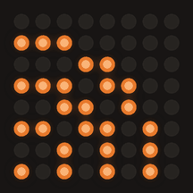
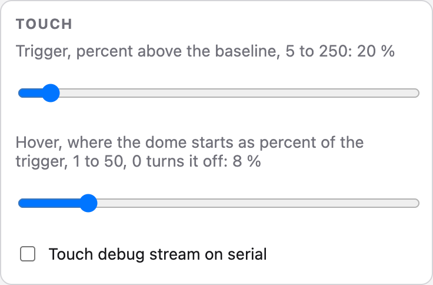

# punkt firmware behaviour

This file documents what the firmware does, in the detail you want when you
have the serial monitor open, when an animation looks wrong or when you are
tuning a setting. The [README](../README.md) covers what the board is and how to
build one, [usage.md](usage.md) how to use it and [reference.md](reference.md)
how to drive it; everything below assumes you have read that far. Every
timing here is the one the firmware uses, and every quoted line is one the board
prints at 115200 baud. Where `strich`, the 16x8 variant with two coins and a
battery, behaves differently, the section says so, and the sections on the
split clock, the battery and the two coins cover `strich` alone.

## Table of contents

- [States](#states)
- [Working animations](#working-animations)
- [Sessions and the watchdog](#sessions-and-the-watchdog)
- [Views](#views)
- [Split clock](#split-clock)
- [Display cascade](#display-cascade)
- [Link and update pictures](#link-and-update-pictures)
- [The Wi-Fi link](#the-wi-fi-link)
- [Power and temperature](#power-and-temperature)
- [Battery](#battery)
- [Night sleep](#night-sleep)
- [Battery sleep](#battery-sleep)
- [Auto dim](#auto-dim)
- [Touch](#touch)
- [Two coins](#two-coins)
- [Factory reset](#factory-reset)
- [Reset reasons](#reset-reasons)
- [Context and usage](#context-and-usage)

## States

| Picture | State | Triggered by | Animation |
|---------|-------|--------------|-----------|
|  | `off` | API, serial | Dark matrix, the pixel in the bottom right corner lights at brightness 1 for 200 ms every 10 s |
|  | `loading` | boot, start of an OTA update, API, serial | 4-pixel comet running clockwise around the 28-pixel border (44 on the 16x8 strich), one step per 45 ms. A board without stored credentials shows `wifi-search` from boot on instead, and an OTA update the `ota` spiral, see [Link and update pictures](#link-and-update-pictures) |
|  | `idle` | first Wi-Fi connection, the watchdog, API, serial, touch hold, button dismiss | The clock: hours as two 3x4 digits in the top half, minutes as two 3x4 digits in the bottom half shifted one column right, 24-hour with a leading zero, redrawn when the minute changes. Until NTP has delivered the time the centre pixel blinks once a second. On `strich` the full-width face of the `clock` view, and a split picture entered while `idle` keeps only the context gauge on the dark right matrix, see [Views](#views) |
|  | `working` | API, serial | The animation of the session's activity, see [Working animations](#working-animations) |
|  | `attention` | API, serial | 1 s loop: square rings bloom out of the centre every 125 ms, full matrix for 275 ms, then dark |
|  | `done` | API, serial | 3.4 s burst: rings bloom, the full matrix pulses, then it drains row by row from the top, see [Sessions and the watchdog](#sessions-and-the-watchdog) for what follows |
|  | `error` | API, serial | Skull with three short glitch bursts (shifted rows, random pixels, full brightness) per 1.6 s loop |
|  | `waiting` | API, serial | Single pixel drifting along a Lissajous-like path, one step every 400 ms at half brightness |
|  | `compacting` | API, serial | 1.2 s loop, 6 frames of 200 ms: rings pulse inward from radius 3 (3, 3+2, 2, 2+1, 1) down to the 2x2 centre |
|  | `limit` | API, serial | Hourglass: sand drains from the top half to the bottom over 4 levels held 1 s each, 4 s loop |
|  | `unread` | API, serial | Dark matrix, a marker pixel in the top right corner on for 3.5 s and off for 0.5 s, half brightness |
|  | `glitch` | API, serial | 600 ms burst: a 2-pixel thick X with the same three glitch bursts as `error`, 120 ms each, then the X is held at half brightness for 1.5 s, see [Sessions and the watchdog](#sessions-and-the-watchdog) for what follows |

Re-posting a state that is already showing restarts its animation from the
start, so a second `attention` replays the loop. The one exception is
`working`: re-posting it with the same effective animation (the same explicit
override, or no override and an activity whose animation has not changed)
leaves the running animation alone, since tool hooks re-post `working` every
few seconds. Posting `working` with a different animation, or any other state,
restarts as usual.

## Working animations

| Picture | Animation | Default for | Shows |
|---------|-----------|-------------|-------|
|  | `tetris` | none | Blocks of 1-2 by 1-2 pixels fall every 110 ms and stack up, full rows flash and collapse, the grid resets when the stack reaches the top |
|  | `life` | none | Conway's Game of Life on a wrapping 8x8 grid, one generation per 400 ms, reseeded after 60 generations, when everything dies or when the grid stops changing (a still life or a two-step oscillator) |
|  | `knight` | `thinking` | A 2x2 block sweeping across rows 3 and 4 with a trailing column, 1.4 s per full cycle |
|  | `orbit` | `delegating` | The same 4-pixel comet used for `loading`, running clockwise around the border, one step per 45 ms |
|  | `code` | `editing` | Lines of code typed onto a dark matrix from the top down, one pixel per 70 ms: lines open blocks and indent the following lines by one pixel up to two levels, a one pixel line closes a block, longer lines carry a one pixel gap like two words, blank lines mostly follow a closed block, 250 ms between rows, the page holds 500 ms after the last row, then clears and starts over |
|  | `rain` | none | Matrix rain: every column runs its own falling streak, head plus a 2-4 pixel trail, one row per 180-420 ms chosen per run, an idle column restarts with a 6 percent chance every 50 ms so the columns drift out of step |
|  | `scan` | `reading` | The mirror of `code`, a page being read: the same lines stand on the matrix all at once, a cursor runs along every written row from its first to its last pixel, one pixel per 40 ms, inverting the pixel it sits on, 150 ms between rows and blank rows skipped, the page holds 300 ms after the last row, then scrolls up and off one row per 60 ms and the next page takes its place |
|  | `pipes` | none | The 3D pipes screensaver on 8x8: a pipe grows one pixel per 150 ms, staying straight with a 75 percent chance and otherwise turning left or right, and it keeps a dark pixel to every pipe already laid and to its own body, so two runs never go side by side and a pipe never folds back along itself, only diagonal corners touch. Straight ahead it may run into a pipe crossing its way and go through it onto the dark pixel behind, never twice in a row and never out of a turn. A pipe that has run into a dead end is followed 400 ms later by the next one, starting with a single blink (120 ms on, 120 ms off) on a dark pixel with no lit neighbour and somewhere to go. Once no pixel is free enough to start on the matrix holds for 800 ms, clears and the run starts over, typically after three pipes |
|  | `pointer` | `mcp` | A mouse pointer at work: a three pixel L pointing to the upper left, tip plus one arm to the right and one below, glides diagonally and then straight towards a random spot, one pixel per 160 ms. On arrival it rolls once: on 30 percent of the arrivals it clicks, on 20 percent it drags, otherwise it rests. A click drops the arms for three steps of 120 ms while a circular ripple expands from the tip, one ring per step over five rings, then the L reforms. A drag glides at 120 ms per step to a corner at least two pixels away on both axes, drawing the solid rectangle outline from the origin to the cursor, holds the finished rectangle for 600 ms and clears it. Every outcome ends in a rest of 500 ms plus up to 800 ms before the pointer sets off again |
|  | `pong` | none | Pong on 8x8: a three pixel paddle in the first and the last column and a ball crossing the six columns between them, one step per 90 ms, bouncing off the top and bottom rows. The paddle the ball comes at follows it one row per step and reaches every row in time, it only hesitates on 4 percent of the steps, so a rally runs around a dozen crossings before a hesitation lets the ball through: that column flashes three times over 720 ms, both paddles drift back to the middle and the next ball is served towards that side after 350 ms |
|  | `terminal` | `shell` | A shell session scrolling up out of the bottom row: the leftmost pixel of the bottom row is the prompt marker and never goes out, a command types out from column 2 one pixel per 70 ms with a caret blinking 300 ms on and 300 ms off at the next position, lines run 1 to 6 pixels. 250 ms after a command is finished it is pushed into the history, everything shifts up one row and the oldest row falls off the top, a command keeping a pixel in column 0 so past commands stay marked down the left edge. One or two output lines follow, typed the same way but one pixel per 25 ms and without a caret, pushed 100 ms after they are finished and leaving column 0 dark. A blank row is pushed after the last output line of a block, and 150 ms after every push the next line starts |

Which of them plays follows the activity of the session, see
[Activities](usage.md#activities).

## Sessions and the watchdog

Up to 8 Claude Code sessions can share the matrix at once, each tracked as one
entry keyed by a session id of at most 32 characters. A request from a ninth
session is dropped, logged as `punkt: session table full, <state> dropped`. The
empty string `""` is the **anonymous session**: it is what the serial console,
the Makefile and any `/state` call without a `session` field use.

When several sessions are in the table, the matrix shows the one in the
highest-priority state, the most recently updated session breaking a tie:

| State | Priority |
|-------|----------|
| `loading` | 12 (highest) |
| `attention` | 11 |
| `error` | 10 |
| `glitch` | 9 |
| `done` while its burst plays | 8 |
| `waiting` | 7 |
| `compacting` | 6 |
| `working` | 5 |
| `unread` | 3 |
| `limit` | 2 |
| `idle` | 1 (lowest) |

`off` never sits in the table: posting `off` removes that session outright.
When the last named session signs off, the anonymous session is reset to
`idle` with a fresh timestamp instead of leaving the table empty, so quitting
Claude Code shows the clock. Only the anonymous session's own `off`, from
`make off`, the serial console or a `POST /state` without a session, empties
the table and shows `off`; that is the only way the state is shown. The
`loading` the board enters on its own, at boot and when an OTA update starts,
is board-wide: it overrides every session's display and bypasses the session
table entirely until the next state request of any kind. A `loading` posted
over the API or the serial console is an ordinary session state instead, it
outranks every other state and falls back to `idle` with the watchdog like
any busy state.

`done` and `glitch` are the two states that end on their own. After its 3.4 s
burst `done` falls back to `idle`, so the clock shows while Claude waits for
the user. `glitch` runs for 2.1 s in total, its 600 ms burst plus 1.5 s of the
X held at half brightness, counted from the request that posted it, and then
the session returns to the state the glitch interrupted, with that state's own
activity and animation override; a glitch that interrupted `done` returns to
`idle`, and so does one for a session the board did not know yet. Re-posting
`glitch` while one is showing replays the burst and restarts the 2.1 s, and it
still returns to the state from before the first glitch. Every other state
stays until the session's next request or the watchdog. Re-posting a state
replays its burst.

Each session runs its own watchdog off its own last request, which keeps the
display from getting stuck when a hook never fires again for one of them. Two
fixed constants of `SessionTable` gate it, `kStuckResetMin` and `kExpiryMin`:

- Every state change coming from the API or the serial console resets that
  session's own timer. Changes the watchdog makes itself do not.
- `kStuckResetMin` is 10 minutes: a session in a busy state (`working`,
  `attention`, `done`, `error`, `waiting`, `compacting`, `limit` or `glitch`)
  falls back to `idle` once it passes. `unread` is not busy, so it is
  untouched by this stage.
- `kExpiryMin` is 60 minutes: a named session is dropped from the table
  outright once it passes. The anonymous session is exempt, it only ever
  falls back to `idle`, never drops.
- The two are checked off the same timestamp, so a session that fell back to
  `idle` at 10 minutes still expires at 60 minutes from its original request,
  it does not start a fresh window.
- If the 60 minute expiry takes the last named session, the board rests on
  the clock the same way a quit does, instead of showing `off`.

## Views

The views and the way a tap moves between them are in
[Views and gauges](usage.md#views-and-gauges). The rules around them:

- **Break-through states**: `attention`, `error`, `loading` and `off` show
  their own animation in every view, the `off` view included, and the view's
  picture returns as soon as the state changes away from them. On `strich`
  `attention` and `error` keep the [split clock](#split-clock) beside them on
  the left, `loading` and `off` take both matrices. The
  [link and update pictures](#link-and-update-pictures) sit above even these.
- **The `off` view** darkens the matrix for one of three reasons: a double tap
  or `POST /view off`, the off stage of [the display cascade](#display-cascade)
  or the [night window](#night-sleep). Only the first is not part of the tap
  cycle and needs no session; it is sticky, exactly like any other manual view
  change, until a double tap or a `POST /view` naming another view, a new
  session included, a second `off` changes nothing. The other two end on
  their own, see
  [the display cascade](#display-cascade) for what wakes each and where the
  view lands. It only darkens the matrix, Wi-Fi, the HTTP API and the sessions
  stay up, unlike the deep sleep option of the [night window](#night-sleep).
- **What `idle` shows**: the clock in `clock` and `normal`, on `strich` in
  `normal` the split picture with the clock on the left and only the context
  gauge on the dark right matrix, the usage gauge in `usage` and a dark matrix
  in `off`. Without a named session `usage` shows the clock as well, since the
  percentage has nothing to refer to then.
- **`idle` returns to the clock**: when the shown state turns `idle` from any
  other state, a settled `done` or an ended turn, `normal` falls back to
  `clock` on its own without counting as activity, like the clock timeout
  (`punkt: view clock (idle)`). A `normal` view entered while the state
  already was `idle` stays, and `usage` is left alone.
- **One-shots end unseen**: `done` ends right away while the view shows
  another animation in its place, the session falling straight back to `idle`
  without the burst ever being seen. `glitch` runs out 2.1 s after its
  request whether or not the view shows it, so it never replays later.
- **Refused changes**: without a named session a view change is refused, the
  view stays, the glitch flashes for 1.5 s as a "nothing connected" sign and
  the picture before it returns, the clock unless the board is off. Entering
  and leaving `off` is the exception and is always accepted. `POST /view`
  checks the same rule before it queues the change and answers 409 without
  the flash.
- **A state request pulls the view to `normal`**: every `POST /state` except
  `off`, which only removes the session, `idle`, which rests on the clock, and
  `unread`, which keeps it and only adds the marker pixel, moves the view from `clock` or `usage` to `normal`, so the matrix shows what
  Claude is doing, and a state posted with a Makefile target is seen even when
  the board was resting on the clock (`punkt: view normal (api)`). The same
  request also wakes the screen first if a timeout or the night window turned
  it off, see [the display cascade](#display-cascade). A tap can still move on
  from there, and while a session keeps posting the next command pulls it
  back. The serial console state commands go the same way, the BOOT button and
  a touch gesture never move the view. While the clock face is shown and the
  displayed session is `unread`, the clock draws a marker pixel with the unread
  rhythm (on 3.5 s, off 0.5 s) at viewport (7, 0) on `punkt` and canvas (8, 0)
  on `strich`, the side clock never shows it. A shown busy state that turns
  `unread` in `normal` returns to `clock` like `idle` does
  (`punkt: view clock (unread)`).
- **The clock timeout**: `normal` and `usage` fall back to `clock` on their
  own once `clockTimeoutMin` minutes passed without a state request over the
  API and without a manual view change while a named session is
  registered (`punkt: view clock (timeout)`), and the next command pulls the
  view back to `normal`. `clock` and `off` are never touched by it, and
  without a named session it does not run since the matrix shows the clock
  anyway. Resting on the clock from there feeds the rest of
  [the display cascade](#display-cascade).

The view is not persisted, the board boots in `clock`.

On `strich` the `clock` view shows a full face across the 16x8 canvas, picked
by the `clockFace` setting. Both faces draw the hours at columns 0 and 4 and
the minutes at columns 9 and 13 in the 3x4 digits of the punkt clock, 24-hour
with a leading zero, so columns 7 and 8 stay dark between the pairs:

| Picture | Face | Digits |
|---------|------|--------|
|  | `tall` | The default on `strich`. Every digit row drawn twice, 3x8 digits over the full height |
|  | `staircase` | The digits at their own size, the hours on rows 0 to 3 and the minutes on rows 4 to 7 |

Until NTP has delivered the time pixel (7, 3) blinks once a second, 500 ms
lit. The unread marker at (8, 0) and the [low-battery dot](#battery) at (7, 7)
blink in the dark gap between the pairs.

On `strich` a change between the full clock face and a split picture slides in
whole-pixel steps: the clock walks from the full face into the
[split clock](#split-clock) of the chosen style, and the picture then wipes in
from column 8, 35 ms per column, about 1 s in all. The way back runs the same
frames in reverse. Nothing slides while a touch ripple runs or before the time is synced,
so a change from Claude, the HTTP API or the clock timeout slides while a touch
gesture cuts over at once under its ripple. A change that arrives mid-slide
lands the slide at once and starts from there. The return to `clock` when the
shown state turns `idle` slides the same way. A split picture entered while the
state already was `idle` shows only the context gauge on the bottom row of the
dark right matrix.

The `battery` view of `strich` sits left of the full clock on a strip, battery,
clock, split picture, which the swipes walk one step at a time, see
[Two coins](#two-coins). It shows the charge estimate described under
[Battery](#battery). Entering `battery` and leaving it for `clock` need no session. It
returns to `clock` 30 s after the last activity without counting as activity
(`punkt: view clock (battery timeout)`), a `POST /state` pulls it to `normal`
like `clock` and `usage`, and the display cascade waits until the clock is back
since it only counts while the clock shows. A change between the battery face
and the clock face or a split picture that no touch reveal covers, the
timeout, Claude or `POST /view`, wipes the new picture in one column every
35 ms from the side it lies on along the strip, from the left into `battery`
and from the right out of it, about 0.6 s; under a touch gesture the ripple or
the swipe disc reveals it instead.

## Split clock

On `strich` the left matrix carries a clock of its own beside every picture
that takes only the right matrix: the animations of the `normal` view, the
usage gauge, `attention` and `error` breaking through any view, the glitch
flash of a refused view change and a preview. The hours stand in the top half
as two 3x4 digits at columns 0 and 4, the same in every style, and the
`splitClock` setting picks how the minutes below them look. 20:47 in each
style:

```
digits      squares     stagger     bar
###.###.    ###.###.    ###.###.    ###.###.
..#.#.#.    ..#.#.#.    ..#.#.#.    ..#.#.#.
##..#.#.    ##..#.#.    ##..#.#.    ##..#.#.
###.###.    ###.###.    ###.###.    ###.###.
........    ........    .#.#.###    ........
#.#.###.    ....#...    .###...#    ........
###...#.    #...###.    ...#..#.    #######.
..#...#.    ###.###.    ...#..#.    ####....
```

| Picture | Style | Minutes |
|---------|-------|---------|
|  | `digits` | The default. Two 3x3 digits at columns 0 and 4 on rows 5 to 7, row 4 dark |
|  | `squares` | Two 3x3 squares at columns 0 and 4 on rows 5 to 7, row 4 dark. The left one lights one pixel per ten minutes (0 to 5), the right one one pixel per minute of the ten (0 to 9), each filling like a glass: the bottom row left to right, then row 6, then row 5 |
|  | `stagger` | The punkt clock: two 3x4 digits at columns 1 and 5 on rows 4 to 7, the minute ones reach column 7 |
|  | `bar` | A bar of `round(minute * 14 / 60)` pixels, the first 7 on row 6 from column 0, the rest on row 7, rows 4 and 5 dark |

Column 7 stays dark in every style but `stagger`, so a dark column separates
the clock from the picture starting at column 8. The 3x3 digits of `digits`:

```
0    1    2    3    4    5    6    7    8    9
###  ##.  ##.  ###  #.#  .##  #..  ###  .##  ###
#.#  .#.  .#.  .##  ###  .#.  ###  ..#  ###  ###
###  ###  .##  ###  ..#  ##.  ###  ..#  ##.  ..#
```

Until NTP has delivered the time the centre pixel (3, 3) blinks once a second,
500 ms lit, in every style, like the punkt clock. The clock reads the time and
the style once a second, a new style shows at once and so does a new minute,
except in `squares`: a pixel the squares gain simply appears, but when the
tens change the ones square first drains from the top, one pixel per 35 ms,
before the tens square gains its pixel, and at the hour (59 to 00) the ones
square drains, then the tens square drains the same way and only then do the
hours change. Every step on the way shows a real minute, 20:59 to 21:00 takes
15 steps, about 0.5 s. The [low-battery dot](#battery) blinks at (7, 7) over
whatever the style draws there.

The slide from the full face into a split picture walks a path of whole-pixel
steps whose last clock frame is exactly the split clock's picture, so the split
clock takes over without a visible change before the picture wipes in from
column 8, 35 ms per column. Every path starts with the squash of a `tall` face
into the `staircase` one, 4 rows of 80 ms each; a `staircase` face starts after
it. From there:

| Style | Path from the `staircase` face |
|-------|-------------------------------|
| `digits` | One 80 ms step switches the minutes to the 3x3 digits on rows 5 to 7 at their columns 9 and 13, then they slide 9 columns left to columns 0 and 4, 50 ms per column |
| `squares` | The minute pair drops off the bottom edge, one row per 50 ms over 4 rows, then the tens square fills one pixel per 35 ms, then the ones square the same way |
| `stagger` | The minute pair moves 8 columns left under the hours, 50 ms per column |
| `bar` | The same drop as `squares`, then the bar fills one pixel per 30 ms |

The way back to the full face runs the same frames in reverse, each step
waiting as long as the step into it. The time is held for the whole slide, so
`squares` and `bar` take one step per lit pixel of the minute they started
with: 20:47 in `squares` walks 4 + 4 + 4 + 7 steps from the `tall` face, about
0.9 s before the wipe.


## Display cascade

Brightness and the screen step down together, one stage counted from the one
before, and any **activity** rewinds the whole thing back to the top: a
`POST /state`, a `POST /view`, a touch, a button press or a preview. A context
or a usage push does not count, the status line posts those on every render
whether or not anyone is at the keyboard.

```
activity -> clockTimeoutMin -> clock face -> dimTimeoutMin -> dimmed
         -> offTimeoutMin -> screen off
```

The first arrow is [the clock timeout](#views) above. Once the clock face
itself has rested for `dimTimeoutMin` minutes, the brightness ceiling drops to
`min(sunLevel, nightBrightness)`, the lower of what [auto dim](#auto-dim)
computes and the `nightBrightness` setting, ramped down over 2 s and back up
over the usual 150 ms, logged as `punkt: rest dim on` and `punkt: rest dim
off`; `GET /state` reports it as `dimmed`. `attention`, `error`, a Claude
hook, which pulls the view back to `normal`, and a tap all end the rest by
themselves. A further `offTimeoutMin` minutes of the same rest, past the dim
stage, switches the screen off (`punkt: view off (timeout)`). `0` disables
either stage.

The screen goes dark for one of three reasons, reported as `offReason` in
`GET /state`:

| Reason | Entered by | Ends on |
|--------|-----------|---------|
| `manual` | A double tap or `POST /view off` | A double tap or a `POST /view` naming another view, exactly like any other manual view change |
| `timeout` | The off stage above | Any `POST /state` except a sign-off, or any touch gesture |
| `schedule` | The [night window](#night-sleep) with `nightOff` on | Any `POST /state` except a sign-off, any touch gesture, or the window closing on its own |

A touch gesture that wakes the screen this way is consumed as the wake and
does nothing else (`punkt: touch, screen on`). Either way the view returns to
the one showing before the screen went dark, and break-through states
(`attention`, `error`, `loading`) still show through every off, exactly as
they show through every other view. The [night window](#night-sleep) logs
`punkt: view off (night)` when it darkens the screen this way and
`punkt: view on (night over)` when the window closes, or `nightOff` turns off,
while the `schedule` reason still holds.

## Link and update pictures

Four pictures sit above the view and the state logic and replace whatever is on
the matrix while their condition holds. None of them is a state: the view, the
sessions and the states stay as they are, nothing is stored, and the picture
from before returns on its own once the condition ends. `GET /state` reports
the one that shows as its `animation`, the animation on the matrix.

| Picture | Name | Shows while |
|---------|------|-------------|
|  | `reset` | The [factory reset](#factory-reset) fill runs, from 2 s of contact |
|  | `wifi-search` | The `punkt-setup` portal runs on a board without stored credentials, from boot on |
|  | `wifi-lost` | Stored credentials carry no link, the board keeps retrying |
|  | `ota` | An [over the air](../README.md#6-ota-updates) update is being received, a spiral filling inward from the bottom left corner, one pixel per 64th of the image |

They win in that order, the reset fill first and the OTA spiral last, and the
`off` view stays dark through both Wi-Fi pictures. The state changes they cause
are logged by the usual formatter with the sources `(link)`, `(ota)` and
`(ota end)`.

Both Wi-Fi pictures draw the same symbol, a dot in the bottom left pixel and
three quarter arcs at radius 2, 4 and 6 around it:

```
........
###.....
...##...
###.##..
..##.#..
##.##.#.
..#.#.#.
#.#.#.#.
```

`wifi-search` starts with the dot alone and lights one arc more every 350 ms,
then holds 500 ms dark and starts over, a 1.9 s loop. `wifi-lost` blinks the
full symbol, 1 s on and 1 s off. On `strich` the symbol sits centred on the
16x8 canvas.

`wifi-lost` appears when stored credentials have not connected 15 s after boot
(`punkt: link lost, connect timeout`), and during operation from the moment the
link watchdog gives up, the same moment it logs `punkt: wifi reconnect` after
10 s down, see [The Wi-Fi link](#the-wi-fi-link). A shorter outage shows
nothing. Credentials that fail never open the `punkt-setup` AP: the board keeps
reassociating every 10 s behind the symbol until the network is back, so a
power cut that also takes the router down ends with the board on the network
again once the router is up.

Either picture gives way as soon as the link is back (`punkt: wifi back <ip>`
or `punkt: wifi connected <ip>`). Booting with stored credentials that connect
shows the loading comet and then the normal picture.

`ota` fills along an inward spiral, counter-clockwise, the opposite way round
from the loading comet. The first pixel is the bottom left corner, the path
runs right along the bottom row, up the right column, left along the top row
and down the left column, then turns one ring inward and laps the 6x6 ring,
the 4x4 ring and the 2x2 centre the same way, 64 pixels ending in the middle.
Lit pixels stay lit and the head does not blink, so half a firmware image
leaves the border closed and the second lap half done:

```
########
#......#
#......#
#......#
#......#
#......#
#####..#
########
```

## The Wi-Fi link

The station transmits at 8.5 dBm and uses 20 MHz channels only. Both are set
again every time the station interface starts and logged once, at the first
connection, as `punkt: wifi tx=34/4dBm bw=ht20`: the Super
Mini's onboard antenna reflects at full power, and the lower level links
farther on it. With the `powerSave` setting on (the default) the station
runs Wi-Fi modem sleep in its minimum mode and wakes for every beacon, see
[Power and temperature](#power-and-temperature).

At boot the board waits up to 5 s for the stored credentials to connect before
it draws, a slower connect is picked up afterwards. When that wait runs out it
logs `punkt: wifi connect pending, retrying`, and credentials that have still
not connected 15 s after boot log `punkt: link lost, connect timeout`. From
then on the board reassociates every 10 s, each attempt logged as
`punkt: wifi reconnect`, until `punkt: wifi connected <ip>` finally follows.
The setup portal is never opened for stored credentials, only a board without
any runs it.

A link watchdog polls the connection every 250 ms once it is up: the moment the
station is not associated any more it logs `punkt: wifi lost`, and once the
link has been down for 10 s it reassociates, logs `punkt: wifi reconnect` and
repeats the 10 s wait if the link is still down afterwards. Coming back logs
`punkt: wifi back <ip>`. The matrix follows the watchdog rather than the single
dropout: from the `punkt: wifi reconnect` line on it shows `wifi-lost`, and an
outage shorter than those 10 s leaves the display alone.

The settings page and the API only exist once Wi-Fi is up: the setup portal
owns port 80 while the setup AP runs on a board without credentials, and the
API server is started on the first connection. A connection that came out of a
portal save restarts the board first, logged as `punkt: wifi saved, restarting`, since the portal's HTTP
connections hold port 80 for minutes afterwards and the API server would fail
to bind it, silently. The whole matrix lights for 300 ms at the brightness
ceiling to acknowledge the save, then the board restarts. The next boot
connects with the saved credentials directly and starts the server on a free
port. The server checks its socket every 5 s: a bind that failed anyway, or a
listener that died later, is logged as
`punkt: http failed to listen on port 80, retrying` and started again until
`punkt: http listening on port 80` follows.

## Power and temperature

The chip runs cooler with the `powerSave` setting on, the default:

- CPU at 80 MHz instead of 240 MHz. The APB bus stays at 80 MHz either way, so
  I2C and the USB serial port are unaffected.
- Wi-Fi modem sleep in its minimum mode, the radio wakes for every beacon,
  logged at connection time as `punkt: wifi ps=min-modem listen=<n>`, where the
  listen interval is a driver value. Requests take a little longer to be
  answered while the radio sleeps, the web server, mDNS and OTA keep working.

Turning it off switches to 240 MHz and no modem sleep, immediately
(`make set K=powerSave V=false`), logged as
`punkt: power save off cpu=240 wifi=none`.

The chip temperature is sampled 5 s after boot and then once a minute, logged
as `punkt: temp 48.3C cpu=80` and reported as `temperatureC` in `GET /state`
(`null` before the first sample).

## Battery

`strich` runs from a single-cell LiPo on the BAT pads of the Super Mini, which
charges it from USB and feeds VBUS from it through a diode once USB is gone.
GPIO3 reads VBUS through the 100k/100k divider that is already on the Super
Mini, nothing to wire, so the pin sees half of it. Every 200 ms the firmware
averages 16 readings of the pin: above 2250 mV, a VBUS above 4.5 V, USB is
present, below it the board runs on the battery. On battery VBUS is the cell
voltage less the drop of a plain diode, not a Schottky, about 0.7 to 0.85 V
under load, so the same pin doubles as a rough gauge of the cell.
`GET /state` reports both under `power`: `usb` and `vbusMv`, the VBUS voltage
in millivolts.

The charge estimate only runs on battery. Every 200 ms battery sample feeds an
exponential average with a time constant of 3.2 s, seeded by the first battery
sample after boot or after USB went away, the average maps to a percentage by
linear interpolation between points measured on one cell (3300 mV 100 %,
3150 mV 85 %, 3050 mV 70 %, 2950 mV 55 %, 2850 mV 35 %, 2750 mV 15 %, 2600 mV
0 %), and the shown value only moves once the estimate 4 mV either side of the
average no longer covers it, so the digits do not flicker. The `battery` view
shows it, see [Views](#views), and `GET /state` reports it as `power.percent`.
On USB the pin reads the charger, the percentage is unknown and `percent` is
missing, as it is before the first battery sample.

The `battery` view draws a battery outline over the canvas, columns 0 to 14 on
all eight rows with the terminal nub at column 15 on rows 2 to 5. On battery
its 13x6 inside fills from column 1, `round(percent * 13 / 100)` columns, and
the percentage stands centred on rows 2 to 5 in the 3x4 digits of the clock, at
most `99`, every digit pixel inverting the fill beneath it. On USB a still 5x6
lightning bolt sits centred inside instead, and before the first battery
sample the outline stays empty. The face redraws when the USB presence or the
shown percentage changes.


A change of USB presence moves the ground reference of both coins and with it
every touch reading at once, which would read as two fingers on the coins and
arm the factory reset. The firmware therefore rebases both coins on every
change, see [Two coins](#two-coins), logged as
`punkt: usb power changed, rebasing the coins`.

While the board runs on battery and the estimate is below 15 percent, a dot
blinks at canvas (7, 7), 500 ms lit and 500 ms dark, the rhythm starting over
each time the dot turns on. It shows in the full clock face and in the
[split clock](#split-clock), over whatever pixel the face draws there, and in
no other picture. It clears once the estimate reads 18 percent or more or USB
is back, and between 15 and 18 percent it keeps its last state, so an estimate
wavering at the threshold does not make it flicker.


The matrices hang on the 5V pad, which carries VBUS, so on battery they run
from the cell voltage less the diode drop and are noticeably dimmer than on
USB. What the battery feeding VBUS means for charging is under
[Known limitations](usage.md#known-limitations). How the board saves the cell
when nobody uses it is under [Battery sleep](#battery-sleep).

## Night sleep

`nightOff` puts the screen to sleep for a window of the day, from `sleepAt`
(default `22:00`) to `wakeAt` (default `07:00`), wrapping past midnight; equal
times make the window zero minutes long, so it never matches, and the window
needs a synced local clock, an unsynced one never matches it either. Checked
every 10 s, the screen switches off inside the window 10 minutes after the
last activity, whether or not a session is open, logged as `punkt: view off
(night)`, see [the display cascade](#display-cascade) for what wakes it again
and where the view lands. The window closes itself too, at `wakeAt`, logged as
`punkt: view on (night over)`.

With `nightSleep` on top of `nightOff` the board goes further and enters
ESP32-S3 deep sleep, matrix, LED and Wi-Fi all dark, instead of leaving the
screen off with the radio up. Checked every 10 s, all of these must hold: the
window as above, no named Claude Code session in the table and the board not
in its own `loading` from boot or an OTA update, and no button release or
touch gesture in the last 10 minutes, boot counting as one. A session that is
still open at `sleepAt` therefore keeps the board from the deep sleep, though
not from the screen switching off, and the deep sleep follows 10 minutes after
the session signs off.

Entering the sleep is logged as `punkt: night sleep at HH:MM, wakes at HH:MM
or by double tap`, or, without a synced clock, as `punkt: night sleep at
HH:MM, double tap wakes`. The matrix is blanked and its HT16K33 oscillator
stopped, the onboard LED kept off, Wi-Fi disconnected and the touch pad armed
as the wake source with the same margin above the baseline the awake trigger
uses (`touchTrigger` percent). With a synced clock the deep sleep timer is
always armed for the next `wakeAt` on top of the touch wake, for the seconds
from the current local time to it, a full day when the two land on the same
minute. Nothing else wakes the board: the BOOT button is GPIO0, which held low
through a reset lands in the ROM bootloader. A Claude Code session that starts
while the board sleeps cannot wake it, a double tap does. The clock survives
the sleep on the RTC, so the window check works right after the wake and NTP
re-syncs later.

A wake has two possible causes and the firmware branches on the one the chip
reports. A wake boots from scratch either way, so the serial log starts with
`punkt: woke by touch from the night sleep` or
`punkt: woke by timer from the night sleep`, followed by
`punkt: reset reason deepsleep` and `punkt: boot not counted`, since neither
cause counts towards the [factory reset](#factory-reset) boot counter, see
[Reset reasons](#reset-reasons). The sleep the board entered is kept in RTC
memory, so a wake out of the [battery sleep](#battery-sleep) of `strich` follows
its own rules instead.

On `strich` the left coin is the touch pad that wakes the board, and it is the
only touch channel the chip scans while asleep: the right coin is taken out of
the scan mask before the sleep starts, so it costs no power and cannot wake it.

A timer wake is the board keeping its own appointment, so it skips the tap
confirmation entirely and continues the normal boot.

A touch wake takes **two taps**. The first touch wakes the chip, that part is
hardware and cannot be filtered, but the firmware then waits **2 seconds** for
a second tap before it brings anything up, and logs either
`punkt: wake confirmed by tap` or `punkt: wake not confirmed, sleeping again`.
Without that tap it goes straight back into deep sleep, so a sleeve brushing
the coin costs about two seconds of boot and nothing else: the matrix stays
dark the whole time, no Wi-Fi, no HTTP server, no animation. If the finger
still rests on the coin during the touch calibration the baseline starts too
high and is corrected by the snap-down described under [Touch](#touch) once the
finger lifts, so the tap that confirms the wake is the one after that lift.
The confirming tap counts the moment it is released, same as any other tap, so
it marks the wake and a double tap that follows to wake the board is swallowed
instead of turning the matrix off again.

## Battery sleep

On battery `strich` puts itself into deep sleep once nobody has used it for a
while, `batterySleepMin` minutes, 15 by default, `0` turns it off. Checked every
10 s while the board runs on battery, all of these must hold: the setting is
above 0, no session is in `working`, `attention`, `error`, `waiting`,
`compacting`, `limit`, `unread` or `done` (a session in `glitch` counts by the
state it returns to), and `batterySleepMin` minutes passed without activity.
Activity is the same as for [the display cascade](#display-cascade), a
`POST /state`, a `POST /view`, a touch gesture, a button press or a preview,
the boot counts as one, and so does unplugging USB: the time without activity
only starts counting the moment USB went away. Sessions resting in `idle` do
not hold the board awake, unlike the night sleep, and neither does a `loading`
that never finished. On USB the sleep never starts.

A nearly empty cell sleeps sooner: with the [charge estimate](#battery) at
3 percent or less the board goes down once 60 s passed without activity,
whatever the setting, the sessions or `loading` say. A wake then still shows
the board for a minute.

Entering the sleep is logged as
`punkt: battery sleep at <percent> percent, left coin or usb wakes`. As for the
night sleep the matrix is put into standby, the onboard LED kept off, Wi-Fi
disconnected and the left coin armed as the wake pad with the margin of the
awake trigger, the only touch channel scanned while asleep. On top of it a
timer wakes the chip every 30 s to look for USB power. The board leaves the
sleep in two ways:

- **A touch on the left coin** boots the board at once, a single touch, no
  confirming tap as after the night sleep. The log starts with
  `punkt: woke by touch from the battery sleep`, and since the boot counts as
  activity the board stays up for `batterySleepMin` minutes again.
- **USB power** is found by the 30 s timer. Right at the start of that boot,
  before the LED, the matrix or Wi-Fi are touched, the firmware reads the sense
  pin once. With USB still absent it logs
  `punkt: woke by timer from the battery sleep` and
  `punkt: still on battery, sleeping again` and goes straight back to sleep
  with the stored wake threshold and a fresh timer, the matrix dark the whole
  time. With USB present it logs `punkt: usb back, leaving the battery sleep`
  and boots normally, so plugging USB in wakes the board within 30 s.

Neither wake counts towards the [factory reset](#factory-reset) boot counter.
The night sleep and the battery sleep are checked independently and the first
one due wins. On USB only the night sleep can run. A night sleep entered on
battery keeps the night rules, it wakes on a touch confirmed by a tap or at
`wakeAt` and does not look for USB, and a board that wakes from it on battery
falls into the battery sleep later like after any other boot.

## Auto dim

With `autoDim` on the brightness ceiling is no longer the `brightness` setting
but a level derived from the sun's elevation at the coordinates of the `city`
setting. The board holds a table of 64 cities in `src/settings/cities.cpp`,
each with its IANA name, its POSIX timezone rule and its city centre
coordinates to two decimals, and `Settings` derives the clock rule and the
position from the chosen entry. The board never knows where it is: the city is
picked on the settings page, by hand or with the button that takes it from the
timezone of the browser showing the page. Browser geolocation is out of reach,
browsers only grant it to secure origins, and `http://punkt.local` is not one,
which was verified in Chrome. City centre coordinates land within a degree or
two of the board, and one degree moves the curve by about 4 minutes, below the
width of one step.
The state machine holds the ceiling in effect and pushes it to every animation
and to the display ramp, the setting is only the day end of the range. Auto dim
and the [night window](#night-sleep) are independent: one dims the matrix, the
other switches the screen off or puts the board into deep sleep.

While the clock rests (see [the display cascade](#display-cascade)) the
ceiling this section computes is additionally capped to `nightBrightness`,
whichever of the two is lower applies, so the resting cap can only ever dim
the matrix further, never brighten it back up.

The mapping is a smoothstep between two elevations. At **-6 degrees** and
below, the end of civil twilight, the ceiling is `nightBrightness`. At
**10 degrees** and above it is `brightness`. In between the elevation is
scaled to 0 to 1, shaped with `t * t * (3 - 2t)` and the level is rounded to
the nearest of the 16 hardware steps, so the matrix glides through them rather
than jumping. The lower threshold is where the sky stops contributing light.
The upper one is deliberately low: outdoors the sun at 10 degrees already
gives tens of thousands of lux, and the eye perceives light logarithmically,
so everything above that reads as daylight. A curve that kept climbing until
noon would make the matrix visibly dimmer at four in the afternoon in winter
than at one, which indoors looks like a fault. With this shape a Berlin winter
noon at about 15 degrees still reaches the day level, and the glide takes
roughly 1.5 to 2 hours each evening and morning at 52 N.

The elevation comes from the NOAA low precision algorithm in
`src/dimming/solarElevation.cpp`: the fractional year from the day of the year
and the hour, the equation of time and the declination as short Fourier series
of it, true solar time as UTC minutes plus the equation of time plus 4 minutes
per degree of longitude, the hour angle as a quarter of that minus 180
degrees, and the elevation from `sin(lat) sin(decl) + cos(lat) cos(decl)
cos(ha)`. It is accurate to about half a degree, which is well below the width
of one step of the glide. The moment is UTC, so the timezone setting plays no
part.

`AutoDim` evaluates the level every **30 s** and at once after any settings
change, both through `refresh()`, which also runs at boot. The elevation moves
at most about a quarter of a degree per minute, so a step lands every few
minutes during the glide. One fallback returns the day level: an unsynced
clock, `TimeSync::synced()` is false until the first NTP answer. There is no
unconfigured state, every city carries coordinates. Polar day and polar night
need no special case, the elevation simply stays above or below the
thresholds. Each level
change is logged as `punkt: auto dim level=5 sun=3.2deg`, and `GET /state`
reports the ceiling in effect as `brightness`.

## Touch

This section describes the one coin of `punkt`. The two coins of `strich`
share its electrode handling but take their gestures from a finger tracker,
see [Two coins](#two-coins).

The touch pad, a 5 euro cent coin on a wire to GPIO4, is read with the ESP32-S3
touch sensor, the raw reading rises on touch. At boot the pad is sampled 16
times, the average becomes the baseline and the highest sample minus the
lowest becomes the calibration spread, its noise floor, logged as
`punkt: touch baseline <n> spread <n>`. While nothing touches the coin the
baseline follows slow drift (an exponential moving average
stepped every 200 ms with a divisor of 64, roughly a 13 s time constant), so
humidity and temperature changes do not turn into phantom touches. An
untouched reading that stays at or below 90 percent of the baseline for three
consecutive samples replaces the baseline at once, logged as
`punkt: touch baseline <old> -> <new>, reading dropped`, so removing a longer
wire or lifting a finger that rested on the coin during boot does not
leave an inflated baseline behind. The new baseline is clamped so the level
the reading dropped from still counts as released against it, otherwise a
short dip followed by a recovery would read as a touch that never releases. A
larger drop is followed in those steps, one every 60 ms, so it takes about
400 ms at the default trigger and about 2 s at the lowest one.

A reading counts as touched once it is `touchTrigger` percent above the
baseline (default 25, adjustable on the settings page) for three consecutive
20 ms samples, and as released once it drops back below 40 percent of that
margin (10 percent at the default). Baseline tracking is frozen while
touched, up to 30 seconds.

Attaching a longer wire while the board runs raises the resting reading in one
step. A step past `touchTrigger` reads as a touch that never releases and runs
into the [factory reset](#factory-reset), so attach the wire before power-on,
or raise `touchTrigger` first. After 30 seconds of unbroken contact the
baseline tracks the reading again
(`punkt: touch stuck, tracking the baseline again`) and the pad releases on
its own, which recovers the input but comes after the reset.

A live reading always jitters by a few units between samples. A reading that
stays identical for 10 s while nothing touches the coin means the touch
sensor has stopped measuring, which has been seen once after a factory reset
and portal setup. The firmware then restarts the sensor, logs
`punkt: touch frozen, sensor restarted`, calibrates a fresh baseline and
counts the restart in `touch.restarts` of `GET /state`. A sensor that stays
dead is restarted at most once every 10 s.

| Gesture | Condition | Effect |
|---------|-----------|--------|
| any | the screen is off with `offReason` `timeout` or `schedule` | Lights the screen again, consumed as the wake, nothing else happens, see [the display cascade](#display-cascade) |
| tap | release after less than 800 ms | Acts at once on the release: cycles the view `clock`, `normal`, `usage`, `clock`, ignored while the `off` view is on. While `attention` is shown it acknowledges it instead (that session goes to `working`), and only that acknowledge waits until the 300 ms double tap window closes without a second press |
| double tap | second press starts within 300 ms of the first release | Takes the view change of the tap before it back, then turns the matrix off as the `off` view, or back on with the view it had before, so lighting it again returns to the view the gesture started on, also without a session. After a tap that only woke the screen out of `timeout` or `schedule` it does nothing more |
| hold | release between 800 ms and 2 s, no tap on release | Sets every session to `idle` and ends a `loading` that never finished |
| none | release at or after 2 s | Nothing, the press was a [factory reset](#factory-reset) attempt: the fill cancels and the picture on the matrix is left as it was |

The first row wins whenever it applies, the other rows only run once the
screen is on, off for the `manual` reason, or not off at all. Every gesture is
decided on the release, so a hold acts when the coin is let go
rather than while it is held, and a press that ran into the reset fill leaves
no gesture behind at all. A tap acts on its own release; if no second press
follows, the firmware reports the internal `tap-confirmed` event once the
300 ms double tap window then closes, which is what lets the `attention`
acknowledge wait for it, the confirmation is not recorded as `touch.lastEvent`.
A press that passes 800 ms drops a waiting tap's confirmation, its `tap` was
already reported on the earlier release. All three gestures reset every
session's watchdog.

### Hover dome and ripple

Below `touchTrigger` the same reading still says how close a finger is. The
matrix answers with a half disc growing in from the top edge over whatever is
playing, one radius per hover level:

```
L1  . . . # # . . .    L2  . . # # # # . .    L3  . # # # # # # .
                           . . . # # . . .        . # # # # # # .
                                                  . . # # # # . .
```

The dome is one disc around the point between columns 3 and 4 just above row
0. In doubled coordinates `dx = 2x - 7`, `dy = 2y + 1` a pixel lights when
`dx*dx + dy*dy <= R2`, with `R2` 2, 10 and 34 for level 1 to 3, which draws
exactly the rows above. A dark one pixel keyline, the disc's 4-neighbour
dilation minus the disc itself, is forced off around it so the dome stays
readable over any animation.

The level comes from the raw reading smoothed with an exponential average (a
quarter weight per 20 ms sample) and compared against three entry thresholds
built from the trigger delta above the baseline: `t1 = max(triggerDelta *
touchHover / 100, 2 * spread)`, the calibration spread keeping level 1 off the
noise floor when `touchHover` is set low; `t3 = triggerDelta * 80 / 100`, just
below the touch trigger; and `t2 = sqrt(t1 * t3)`, their geometric middle,
since capacitance rises roughly with 1 over the distance. A level is left
again once the smoothed delta falls below 70 percent of its entry threshold,
so a reading resting on a threshold cannot flicker between two levels. Contact
reads as level 3. The dome only holds level 3 through the double tap window
while a tap still waits to acknowledge `attention`, every other gesture lets
the dome follow the finger down and the ripple starts on the release, and a
stuck electrode (30 s, see above) drops the dome. Baseline drift pauses
while a hover level is held, for at most 5 s, then resumes, so an object left
resting near the pad is drifted into the baseline again and the level falls
back to 0 on its own instead of pinning the dome.

Every touch gesture that switches the picture on the matrix ripples into it
instead of cutting over at once: a tap moving to the next view or
acknowledging `attention`, a double tap into or out of the `off` view, a hold
to `idle`, the wake out of the `timeout` or `schedule` off reason (see
[the display cascade](#display-cascade)), and the glitch flash of a view
change refused for lack of a session (see [Views](#views)). The old frame
freezes outside the ring, the new picture behind it runs live, the same disc
keeps growing on over the far corners as a lit front, its progress eased with
`p = t * (1.5 - 0.5 * t)`: the front starts at 1.5 times the average speed and
slows to half of it by the time the reveal finishes at 240 ms. The ripple
keeps this speed on the 16x8 strich and therefore takes about 450 ms to reach
its far corner. A double tap therefore starts rippling towards the next view on
the first release and then ripples on to dark on the second. A gesture that changes nothing lets the dome
fall back to the hover level instead. Hidden while the reset fill, the OTA
spiral or a Wi-Fi picture owns the matrix (see
[Link and update pictures](#link-and-update-pictures)), and while `touchHover`
is 0.

Brightness carries a floor in both cases: while the dome is lit it is held at
`min(4, ceiling)`, enough to show on the `off` view, which otherwise runs at
brightness 1; through the freeze and the ripple that follows it is held at
whichever is higher, that same floor or the brightness the frozen frame ran
at, so a double tap to `off` does not dim the old picture before the ripple
reveals the dark one. Dropping either floor fades to the requested level over
the usual 150 ms. Hovering is not activity, it wakes and undims nothing, only
a completed gesture runs into [the display cascade](#display-cascade).

Edges and gestures are logged as
`punkt: touch down raw=<raw> base=<baseline>`,
`punkt: touch up raw=<raw> base=<baseline> ms=<press length>`,
`punkt: touch tap` on the release, `punkt: touch tap confirmed` when its
double tap window then closes, `punkt: touch tap, attention waits for the
double tap window` when the tap defers the `attention` acknowledge instead,
`punkt: touch double tap`, `punkt: touch double tap, already the wake` when it
follows a tap that only woke the screen, `punkt: touch hold` and
`punkt: touch reset attempt released, no gesture`. With the `debugTouch`
setting on the firmware also prints
`punkt: touch raw=<raw> base=<baseline> touched=<0|1> prox=<0-3>` every
200 ms, which is the way to tune `touchTrigger`: watch the raw value with and
without a finger, and set the trigger to about half the observed jump.
`touchHover` is tuned the same way, by watching where the dome starts as a
finger comes in and moving the slider until it reacts at the distance you
want. `GET /state` reports the same values, `touch.proximity` included, under
`touch`.



## Two coins

`strich` carries two 2 euro cent coins under its top wall, the left one on
GPIO4 (touch channel T4) above columns 0 to 7 and the right one on GPIO5 (T5)
above columns 8 to 15. Both still run as electrodes the way [Touch](#touch) describes, with
their own baseline, freeze guard and log lines under the names `touch left`
and `touch right`: that is where the deep sleep wake threshold of the left
coin, `touch` and `touchRight` in `GET /state` and their `down` and `up` lines
come from. Their own gestures are dropped. The gestures come from a finger
tracker that reads both coins together and locates one finger along the strip
between them.

### Finger tracking

At boot the tracker reads both coins once, waits 50 ms and averages 16
readings per coin, 10 ms apart, into baselines of its own, logged as
`punkt: coin baselines left=<n> right=<n>`. From then on it samples both coins
every 10 ms. For each coin the reading's delta above its baseline is smoothed
with an exponential average that gives a new reading a weight of 0.6, and
divided by the full touch delta, the baseline times `touchTrigger` percent,
into the coin's **strength**: 1 is a reading `touchTrigger` percent above the
baseline, a firm touch on the coin centre reaches about 2. While no press runs
and neither coin reaches 0.13, each baseline drifts towards its reading with a
weight of 0.002 per sample, a time constant of 5 s, so temperature and humidity
are followed and a finger is not.

The finger column comes from a position model calibrated on the coins of
`strich`: a coin shows a third of its centre signal at its outer edge. Each
coin's delta first loses a noise floor of 10 percent of the full touch delta
and is divided by the larger of its peak in the running gesture and the full
touch delta. Each coin then places the finger between its centre, column 3.5
for the left coin and 11.5 for the right one, and its outer edge, column 0 or
15, by how far that signal fell from 1 towards a third, and the two places are
averaged, weighted by the two signals, so a finger between the coins lands
between their centres. The estimate may move at most 1.5 columns per sample,
which cuts single sample spikes, and then runs through a One Euro filter, a
low pass whose cutoff rises with the speed: 2.5 Hz at rest plus 0.12 Hz per
column per second of the filtered speed, the speed itself filtered at 1 Hz.
The column sits still under a resting finger and follows a moving one with
little lag. Once both coins fall below 0.065, half the 0.13 that marks a finger
as near, the slew limit and the filter restart and both peaks are dropped, so
the next finger is located from its own signal.

A press starts once the stronger coin holds 0.13 for 2 samples and ends once
it stayed below for 4 samples. Its start coin and start column stay
provisional until the press reaches 0.35, a weak early signal mislocates the
finger, and are fixed from then on. A press is a **contact** on one coin when
its start is fixed, its peak reached 0.45 and the other coin stayed below
0.35. A contact also ends once its strength stays below 0.35 for 2 samples
while the finger is within 2 columns of its start column, so a finger hovering
after a tap does not hold the press open. The release decides the gesture:

- **Tap**: a contact released within 700 ms. Every coin keeps its own double
  tap window: a tap whose press starts within 300 ms of the release of a tap
  on the same coin pairs into a double tap, otherwise the tap is confirmed once
  300 ms passed with no press on that coin. A tap on the left coin and one on
  the right never pair.
- **Hold**: a contact released after 800 ms or more, reported with its length.
  Passing 800 ms drops a waiting tap confirmation on that coin. A contact
  released between 700 and 800 ms, or a press that never became a contact,
  is no gesture.
- **Swipe**: decided while the press still runs, once all of these hold: the
  start is fixed, the other coin reached 0.35, the start coin fell below 0.85
  of its peak in the press, the finger is more than 2 columns past the start
  coin's centre towards the other coin (beyond column 5.5 from the left coin,
  before 9.5 from the right one) and it travelled 2.5 columns from its start
  column. The handover gate at 0.85 tells a sliding finger from a second one,
  which keeps the start coin at its peak, and the travel and crossing rules
  exist because pressing harder alone moves the estimate by up to 3.5 columns.
  The swipe is released once the finger stayed below 0.13 for 4 samples, and
  it **completes** when the finger was last seen at least half a column past
  the canvas middle on the far side, column 8 or beyond from the left coin,
  column 7 or below from the right one. Otherwise it is short.

A tap ends without a pause, so the second press of a double tap can follow
within a few samples. A hold, a swipe and a two-finger press end with a 150 ms
settle in which no new press starts, after a swipe with both domes hidden.

Two fingers, one on each coin, are told from one finger between them by
strength: the two-finger hold starts once both coins reach 1.0 and together
2.4 in the same sample, which a single finger in the middle, at about 1.1 and
0.9, does not, and it lasts until either coin falls below 0.7 or the two below
1.68 together. The press it happens in reports nothing on its release, both
tap windows close, and a running swipe ends short. Its length drives the
[factory reset](#factory-reset) fill.

Plugging or unplugging USB moves every reading at once and would read as two
fingers, so each change of USB presence, sampled every 200 ms, rebases both
coins: each takes its current smoothed reading as its baseline, at once and
once more 1 s later while the reading settles. The rebase drops the tap
windows, the two-finger hold and the running press, a running swipe ends
short, and a 150 ms settle with the domes hidden follows.

With the `debugTouch` setting on the tracker prints CSV lines for tuning:
`s,<ms>,<left delta>,<right delta>,<column>,<strength>,<phase>,<disc radius>,<levels>`
for every sample while a finger is near or a gesture runs (phase 0 idle,
1 press, 2 swipe, the two dome levels as two digits),
`i,<ms>,<left delta>,<right delta>,<left base>,<right base>` every 500 ms at
rest, and `g,<ms>,<kind>,coin=<0|1>,dur=<ms>,start=<column>,min=<column>,max=<column>,smax=<peak>,other=<peak>`
for every released press, where the kind is `tap`, `double`, `hold`, `swipe`,
`swipe-back`, `chord` or `none`. The last 8 `g` lines are printed again every
2 s at rest, since the host serial path can drop a burst.

### Gestures on strich

The left coin works the layout, the right one the picture:

| Gesture | Condition | Effect |
|---------|-----------|--------|
| any | the screen is off with `offReason` `timeout` or `schedule` | Lights the screen again, consumed as the wake, a swipe included, see [the display cascade](#display-cascade) |
| left tap | | Acts at once on the release: `clock` -> `normal` -> `battery` -> `clock`, `usage` -> `battery`, and from `clock` straight to `battery` while no named session would allow the split picture. Ignored while the `off` view is on |
| right tap | a state waiting for a human is shown: `attention` or `error` in any view, `limit`, `waiting` or `unread` in `normal` | Changes nothing yet: once the 300 ms double tap window closes without a second tap on the right coin, the displayed session goes `idle`. The right dome stays at the contact level meanwhile, for at most 500 ms |
| right tap | otherwise | Acts at once: `normal` from `clock` or `battery`, toggles `normal` and `usage`. Ignored while the `off` view is on |
| double tap | second press on the same coin within 300 ms of the first release | As on punkt: takes back the view change of the tap before it, then turns the matrix off as the `off` view or lights it again with the view it had before. A dismiss the first tap left waiting is dropped |
| right hold | release between 800 ms and 2 s | Sets every session to `idle` and ends a `loading` that never finished |
| left hold | release between 800 ms and 2 s | Nothing beyond the dome the contact shows |
| none | one coin released at or after 2 s | Nothing |
| none | both coins held | Nothing on the release, from 2 s the [factory reset](#factory-reset) fill runs and 10 s erase the board |
| swipe | left to right | One step towards the battery view: split picture -> `clock` -> `battery` |
| swipe | right to left | One step towards the split picture: `battery` -> `clock` -> `normal`, and `usage` -> `normal` |

So `limit`, `waiting` and `unread`, which only show in `normal`, are dismissed
there, while in `clock` and `usage` a right tap switches the view as usual.
`attention` and `error` break through every view and are dismissed in any of
them. A swipe past an end of the strip or in the `off` view does nothing, and
without a named session a swipe into the split picture is refused with the
glitch flash of [Views](#views) and shows no disc. Every gesture counts as
activity and resets every session's watchdog, except a confirmation that
dismisses nothing and a single-coin hold of 2 s or more.

A swipe switches the view at once beneath a disc. The picture on screen
freezes, the new view starts behind it, and a disc grows out of the start
coin's dome over the whole canvas, following the finger: its radius in the
doubled units of the dome is twice the columns the finger is ahead of the coin
centre plus one, never below the dome radius, and it closes 45 percent of the
gap per sample, so a finger behind the coin centre leaves it at the dome.
Released complete, the disc runs on as the ripple to the far corner at the
ripple's speed and easing, and the view stays. Released short, the disc
shrinks back to the dome radius at the same speed, the view the swipe left is
restored beneath the still frozen picture and the reveal ends, unless
something else changed the view in the meantime. A swipe the tracker stops
reporting for 100 ms without a release ends as a short one. While `touchHover`
is 0, or a system picture owns the matrix, there is no disc and the view only
switches on a complete release.

### Domes and ripple on strich

Each coin draws its own dome in its own half, the disc of
[Hover dome and ripple](#hover-dome-and-ripple) around the point between that
half's columns 3 and 4 just above row 0, with its keyline, clipped to the half.
Both domes may show at once. The levels come from the tracker: level 1 from a
strength of 0.13, level 2 from 0.30 and level 3 from 0.55, each left again
below 70 percent of its entry. Once a press has fixed its start coin only that
coin shows a dome, unless two fingers hold both, and during a swipe and its
settle neither does. `touchHover` does not move these levels, on `strich` it
only turns the domes and the ripples off at `0`, and it still sets the
`proximity` the electrodes report in `GET /state`. The brightness floor is the
same as on punkt.

A gesture that changes the picture ripples into it from the dome of its coin,
at the speed of punkt's ripple: over the whole canvas, about 450 ms to the far
corner, or over the right half alone, 240 ms, for the right tap that toggles
`normal` and `usage`, which leaves the split clock as it is.

Next to the electrode lines the coins log their gestures as
`punkt: touch left tap, view <view>`, `punkt: touch right tap, view <view>`,
`punkt: touch right tap, <state> waits for the double tap window`,
`punkt: touch right tap, dismissing <state>`,
`punkt: touch <coin> tap ignored, screen off`, `punkt: touch <coin>, screen on`,
`punkt: touch double tap, view <view>`, `punkt: touch right hold, forcing idle`,
`punkt: touch <coin> hold of <ms> ms ignored`,
`punkt: touch swipe from <coin>, view <view>`,
`punkt: touch swipe from <coin> ignored, view <view>`,
`punkt: touch swipe complete`, `punkt: touch swipe short, taking it back`,
`punkt: touch swipe taken back, view <view>` and
`punkt: touch swipe ended without its release`.

## Factory reset

Holding the BOOT button or the coin for 10 seconds erases the settings
and the stored Wi-Fi credentials, on `strich` both coins held together as the
two-finger hold of [Two coins](#two-coins), a single coin never resets it.
After 2 seconds the matrix starts filling
from the bottom row upward, reported as the `reset` animation (on `strich`
across the whole 16x8 canvas), and releasing
before it is full cancels the fill and leaves the picture from before
untouched. Once it is full the board restarts into the `punkt-setup` portal as
soon as the button or the coin is released, since GPIO0 held low through a
reset would land in the ROM bootloader instead. An input that never releases, a
shorted pad for example, would leave the board erased and parked, so the restart
also happens **5 seconds** after the erase on its own, logged as
`punkt: still held, restarting into the setup portal anyway`. The serial log
shows `punkt: reset hold, keep holding to erase settings and wifi` at
2 seconds, then `punkt: factory reset, erasing settings and wifi credentials`
and `punkt: release the button to restart`.

What a shorter press does is under
[The coin and the BOOT button](usage.md#the-coin-and-the-boot-button).

The second path erases the Wi-Fi credentials without the button: power cycle
the board three times within 10 seconds of each boot. A boot counter in NVS is
incremented on every counted start and cleared again once the board has been
up for 10 seconds, so three quick cycles in a row trigger the reset: the stored
Wi-Fi credentials are erased, the counter is cleared and the board restarts
into the `punkt-setup` portal. The serial log shows `punkt: boot 2/3 in window`
and finally `punkt: factory reset, erasing wifi credentials`. This path keeps
the settings, only the button hold erases them.

Only a power-on and a reset through the external reset pin count, the two a
person cycling the power or pressing RESET causes. Every other reset leaves
the counter alone and logs `punkt: boot not counted`: a brownout, a watchdog,
a crash, a software restart such as the one after an OTA update, a reset over
USB such as opening the serial port with `make monitor` or the end of a flash,
and a wake from the [night sleep](#night-sleep) or the
[battery sleep](#battery-sleep). Touching the board awake several times in a
row, a flaky USB supply or a crash loop therefore cannot erase the
credentials, see [Reset reasons](#reset-reasons).

## Reset reasons

Every boot logs why the chip restarted, as `punkt: reset reason <reason>`, and
then either `punkt: boot <n>/3 in window` for a counted boot or
`punkt: boot not counted`, see [Factory reset](#factory-reset). The one boot
that logs neither is the 30 s USB check of the [battery sleep](#battery-sleep)
that goes straight back to sleep. `GET /state` reports the reason of the
running boot as `reset`:

| Reason | Reset by | Counted |
|--------|----------|---------|
| `poweron` | Power applied | yes |
| `external` | The external reset pin | yes |
| `software` | A restart from the firmware: OTA update, portal save, `POST /reboot`, factory reset | no |
| `panic` | A crash | no |
| `int-wdt`, `task-wdt`, `wdt` | The interrupt, task or another watchdog | no |
| `deepsleep` | A wake from deep sleep | no |
| `brownout` | The supply voltage dipped | no |
| `sdio` | A reset over SDIO | no |
| `usb` | The USB serial and JTAG unit: the serial port opened, a flash ended | no |
| `unknown` | Anything else | no |

ESP-IDF 4.4 reports a USB reset as unknown, so the firmware asks the ROM's
reset reason for a USB serial or USB JTAG reset before it settles on
`unknown`. When plugging or unplugging USB restarts a `strich` that runs on its
battery, `reset` tells a brownout from a watchdog or a USB reset.

## Context and usage

Both percentages are stored machine-wide with a timestamp, not per session, and
both go stale on their own. The Claude Code status line runs
`~/.claude/hooks/punkt-statusline.sh`, which posts them on every render.

`POST /context` reports how full the context window is. A value older than
10 minutes is stale: the animations are handed `0` (no gauge) and `GET /state`
reports `contextStale: true`. The calm states show it as a bottom-row gauge:
`round(percent * 8 / 100)` pixels light up on the bottom row, left to right.
`waiting` keeps its drifting pixel off the bottom row while the gauge is shown
and `unread` draws the gauge underneath its blinking corner marker. On `strich`
the split picture of a session resting in `idle` shows it too, alone on the
otherwise dark right matrix. Every other animation ignores it.

`POST /usage` reports how much of the 5 hour usage limit of the Claude
subscription is spent. It stays valid for an hour, since the limit does not
move while Claude Code is quiet: after that the view shows nothing and
`GET /state` reports `usageStale: true`. The status line script posts it next
to the context fill from `rate_limits.five_hour.used_percentage`, which Claude
Code only includes for Pro and Max accounts, after the first response of a
session. Without it the usage view shows the placeholder pixel.

The `usage` view shows it: 64 pixels fill the matrix from the bottom row
upward, left to right within a row, one pixel per 1.5625 percent
(`round(percent * 64 / 100)`). From 81 to 95 percent the topmost filled row
blinks slowly (1.5 s on, 0.5 s off). Above 95 percent the blink stops and the
whole gauge pulses once a second between a quarter of the brightness ceiling
and the ceiling instead. Stale or
never reported: a single dim pixel in the bottom left corner. On `strich` the
gauge fills the right matrix beside the [split clock](#split-clock).


