# Using punkt and strich

This page covers the board once it runs: what the matrix shows, the coins, the
views, the settings page and what to do when something goes wrong. Building
and flashing are in the [README](../README.md#quick-start), the parts and the
wiring in [hardware.md](hardware.md), the HTTP API and every setting in
[reference.md](reference.md), and the exact timings and log lines in
[technical.md](technical.md).

Start Claude Code and the matrix leaves the clock and animates what Claude is
doing. Three of the twelve states are the ones that matter: `attention` when
Claude is waiting for an answer, `done` when a turn is finished and `limit`
when the 5 hour usage limit is reached. When the session ends, the matrix shows
the clock again.

## Table of contents

- [What the matrix shows](#what-the-matrix-shows)
- [strich](#strich)
  - [Clock faces](#clock-faces)
  - [Split clock](#split-clock)
  - [Transitions](#transitions)
  - [Two coins on strich](#two-coins-on-strich)
  - [Battery](#battery)
- [Working animations](#working-animations)
- [Activities](#activities)
- [The coin and the BOOT button](#the-coin-and-the-boot-button)
- [Views and gauges](#views-and-gauges)
- [Settings page](#settings-page)
- [Sessions](#sessions)
- [Night sleep](#night-sleep)
- [Auto dim](#auto-dim)
- [Several boards and Claude directories](#several-boards-and-claude-directories)
- [Factory reset](#factory-reset)
- [Troubleshooting](#troubleshooting)
- [Known limitations](#known-limitations)

## What the matrix shows

| Picture | State | With default settings it means | Shows |
|---------|-------|--------------------------------|-------|
|  | `off` | The session ended or timed out, nothing is connected | A dark matrix with a dim heartbeat pixel in the bottom right corner |
|  | `loading` | The board is booting, or an over the air update starts | A comet running around the border |
| 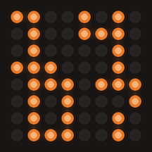 | `idle` | Claude is connected and waiting for you | The clock, the view returns to `clock` on its own when a turn ends, see [Views and gauges](#views-and-gauges) |
| 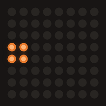 | `working` | Claude is working, the picture tells the activity | One of the working animations below, the knight while thinking |
| 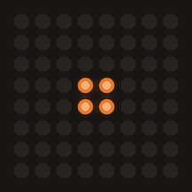 | `attention` | Claude is asking you something: a question, a permission, a dialog | Square rings blooming out of the centre, then a bright flash, looping until you answer or tap the coin |
| 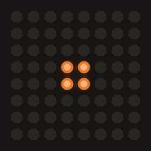 | `done` | The turn is finished | Rings bloom, the matrix pulses and drains row by row, then the session falls back to `idle` |
|  | `error` | The turn failed with an API error | A skull with short glitch bursts |
| 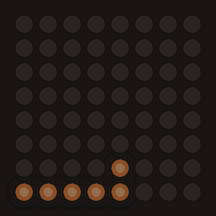 | `waiting` | Claude is waiting on something long running, a monitor or a background task | A single pixel drifting across the matrix |
| 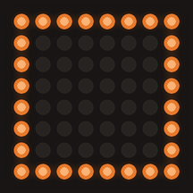 | `compacting` | The context window is being compacted | Rings pulsing inward to the 2x2 centre |
| 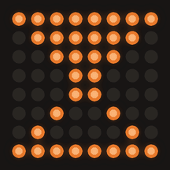 | `limit` | The 5 hour usage limit is reached, or the API is overloaded | An hourglass with sand draining into the bottom half |
| 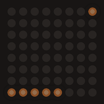 | `unread` | Claude finished a while ago and nothing was typed since | A dark matrix with a softly blinking corner marker |
| 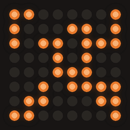 | `glitch` | A tool call failed, the turn goes on | A short glitch burst, then a dim X for 1.5 s before the interrupted picture returns |

The exact timings of each animation are in [States](technical.md#states).

## strich

strich lays the pictures out over two 8x8 matrices side by side, a 16x8
canvas. The left matrix is the clock and the right matrix is Claude: the state
animations, the working animations and the usage gauge all play on the right
matrix, with a clock of its own on the left beside them, the split clock. Only
the full clock face, the battery view, `loading`, `off` and the system
pictures, the Wi-Fi symbols, the OTA spiral and the factory reset fill, take
both matrices. The views are those of [Views and gauges](#views-and-gauges),
plus `battery`:

| Picture | View | Shows |
|---------|------|-------|
|  | `clock` | The full clock face across both matrices, see [Clock faces](#clock-faces). The board boots here, and `normal` returns here when a turn ends |
| 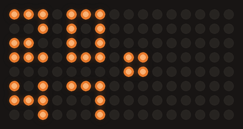 | `normal` | The split picture: the split clock on the left, the animation of the displayed state on the right. A session resting in `idle` leaves the right matrix dark but for the context gauge on its bottom row |
| 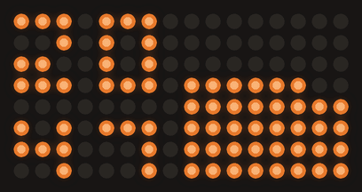 | `usage` | The split clock on the left, the 5 hour usage gauge filling the right matrix |
| 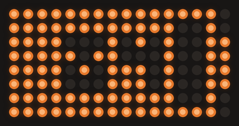 | `battery` | The estimated charge of the cell across both matrices, needs no session, see [Battery](#battery) |
| | `off` | Both matrices dark but for the dim heartbeat pixel in the bottom right corner of the right one |

`attention` and `error` break through every view as on punkt and keep the
split clock beside them, so the full clock face or the battery view turns into
the split picture for as long as they show. `loading` and the `off` state
break through with both matrices. A [preview](reference.md#post-preview) plays an
animation on the right beside the split clock, and the clock, `off` and the
system pictures across both matrices.

When a turn ends, `normal` returns to `clock` as on punkt and strich slides
back to the full face, see [Transitions](#transitions). A split picture
entered by a tap or a swipe while the session already rests in `idle` stays.
`unread` on the full face is a marker pixel blinking at the top left of the
right matrix; in `normal` the `unread` picture plays on the right matrix and
the split clock shows no marker.

### Clock faces

`clockFace` picks the face of the `clock` view, on the settings page under
Location and clock or with `make set K=clockFace V=staircase`:

| Picture | Face | Reads |
|---------|------|-------|
|  | `tall` | The default. Four digits over the full height, the hours on the left matrix and the minutes on the right |
| 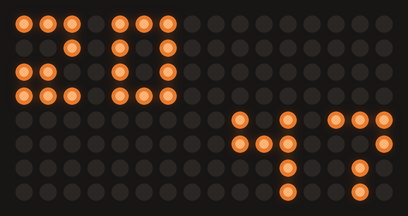 | `staircase` | The digits of the punkt clock at their own size, the hours in the top half of the left matrix and the minutes in the bottom half of the right one, one step down from left to right |

Until NTP has delivered the time a single pixel near the centre blinks once a
second instead, as on punkt.

### Split clock

`splitClock` picks the clock on the left matrix of the split picture. The
hours stand in its top half as two digits, the same in every style, and the
style sets how the minutes below them look. Column 7 stays dark in every style
but `stagger`, so a dark column parts the clock from the picture:

| Picture | Style | Reads |
|---------|-------|-------|
| 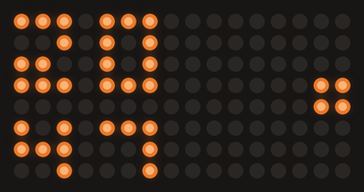 | `digits` | The default. The minutes as two smaller digits, three pixels high, under the hours |
| 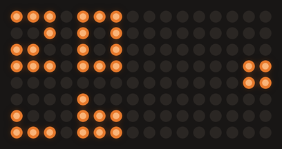 | `squares` | The minutes as two 3x3 squares that fill like a glass from the bottom row: the left one lights one pixel per ten minutes, the right one one pixel per minute of the ten, so :47 lights four pixels and seven. When the tens change the right square drains before the left one gains its pixel |
| 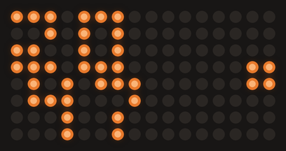 | `stagger` | The punkt clock: the minutes as two digits of the hours' size in the bottom half, one column further right, reaching into column 7 |
| 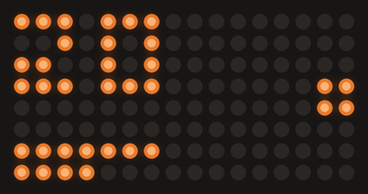 | `bar` | The minutes as a bar of one pixel per four minutes or so, along row 6 first and then row 7: row 6 full is :30, both rows full :58 |

Set it on the settings page or with `make set K=splitClock V=squares`. Every
style pixel by pixel, how `squares` rolls over the hour and the slide paths
are in [Split clock](technical.md#split-clock).

### Transitions

A change between the full clock face and the split picture slides in whole
pixel steps: the full face walks into the split clock of the chosen style,
then the picture wipes in across the right matrix one column at a time, about
a second in all, and the way back runs the same steps in reverse. It slides
for a change from Claude, from `POST /view` or from the clock timeout, and for
the return to the clock when a turn ends. Before the time is synced the
picture changes at once.

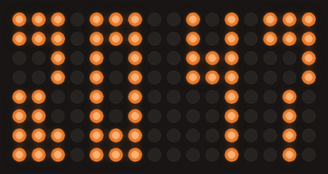

Between the battery view and the clock face or the split picture the new
picture wipes in one column at a time from the side it lies on along the
strip, from the left into `battery` and from the right out of it, in about
0.6 s.

A coin gesture changes the picture under a ripple instead, as on punkt: the
old frame freezes and the new picture spreads out from the dome of the coin,
over both matrices in about 450 ms, or over the right matrix alone for the
right tap between `normal` and `usage`, which leaves the split clock as it is.
A swipe reveals the new view beneath a disc that follows the finger, see
[Two coins on strich](#two-coins-on-strich). The timings are in
[Views](technical.md#views), [Split clock](technical.md#split-clock) and
[Domes and ripple on strich](technical.md#domes-and-ripple-on-strich).

### Two coins on strich

strich has two 2 euro cent coins under its top wall. The one on GPIO4 is the left coin and
the only one that wakes the board from deep sleep, a second one on GPIO5 is
the right coin. The left coin works the layout, the right one the picture:

| Gesture | Does |
|---------|------|
| left tap | Cycles the full clock, the split picture and the battery view: `clock` -> `normal` -> `battery` -> `clock`, `usage` -> `battery`. Without a session `clock` goes straight to `battery` |
| right tap | Dismisses a shown state that waits for a human, its session goes `idle` once the double tap window passed: `attention` and `error` in any view, `limit`, `waiting` and `unread` in `normal`. Otherwise enters `normal` from `clock` or `battery`, or toggles `normal` and `usage` inside the split picture |
| double tap | Two taps on the same coin, either one, take back the view change of the tap before them, then turn the matrix off or light it again, as on punkt |
| right hold | Released between 800 ms and 2 s, sets every session to `idle`. A longer hold does nothing |
| left hold | Nothing beyond the dome, the brightness is set on the [settings page](#settings-page) |
| both coins held | From 2 s the [factory reset](#factory-reset) fill runs and 10 s erase the board, releasing either coin cancels it. Neither single coin hold acts while both are held |

Sliding a finger across the top swipes along a strip of three pictures, the
battery view, the full clock and the split picture: left to right moves one
step toward the battery view (split picture -> `clock` -> `battery`), right to
left one step toward the split picture (`battery` -> `clock` -> `normal`), and
from `usage` back to `normal`. Both
coins are sampled every 10 ms and the finger's position is estimated between
them, so the swipe is recognised while the finger still moves. The new view
switches in at once beneath a disc that grows out of the start coin's dome and
follows the finger with a lit front. Released past the middle, the disc runs
on as the ripple and the view stays; released short, it shrinks back and the
view returns. A swipe past an end of the strip or in the `off` view does
nothing, without a session the change into the split picture is refused. How
the firmware tells a tap, a hold and a swipe apart is in
[Two coins](technical.md#two-coins).

A tap acts on its release, the `off` view ignores single taps, and while a
timeout or the night window turned the screen off any gesture only lights it
again, as on punkt. `touchTrigger` and `debugTouch` apply to both coins, with
`debugTouch` the serial log streams both readings and the tuning lines of the
finger tracker. Each coin raises its own dome over its own matrix as a finger
comes near. `touchHover` only turns the domes and the ripples off at `0` on
strich, the domes follow fixed levels of the finger tracker.

### Battery

The `battery` view shows the charge of the cell: a battery outline across both
matrices, filled from the left in proportion, with the percentage centred
inside in digits that invert where the fill runs under them, `99` for a full
cell. The percentage is a rough estimate, the VBUS voltage smoothed over a few
seconds and mapped along a curve measured on one cell. On USB the voltage says
nothing about the cell, so nothing is measured: the outline holds a still
lightning bolt instead of the fill and the digits. The left tap and the swipe
reach the view, and so does `make view V=battery`. It needs no session,
returns to `clock` on its own 30 s after the last activity, and a
`POST /state` pulls it to `normal` like `clock` and `usage`.


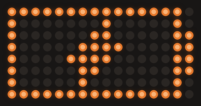

Below 15 percent on battery a dot blinks in column 7 of the bottom row, the
bottom right corner of the left matrix, in the full clock face and in the
split clock, until the estimate is back at 18 percent or USB is plugged in.

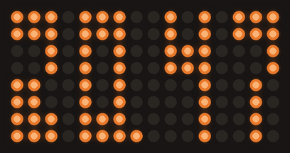

On battery strich also goes to deep sleep after `batterySleepMin` minutes
without use, 15 by default, as long as no session is busy or waits for you,
and after one minute without use whatever the sessions do once the cell is
nearly empty. A single touch on the left coin wakes it, no second tap needed,
and so does plugging in USB, which the sleeping board looks for every 30 s
with the matrix dark. The details are in [Battery](technical.md#battery) and
[Battery sleep](technical.md#battery-sleep), and what the battery means for
charging is under [Known limitations](#known-limitations).

## Working animations

The `working` state plays one of eleven animations. Six of them are tied to what
Claude is doing out of the box, so with default settings the picture tells you
the activity:

| Picture | Animation | With default settings it means | Shows |
|---------|-----------|--------------------------------|-------|
|  | `knight` | Claude is **thinking**: a prompt was submitted, or a tool without an activity of its own runs | A 2x2 block sweeping across the two middle rows with a trailing column, back and forth every 1.4 s |
|  | `scan` | Claude is **reading**: `Read`, `Grep`, `Glob`, `WebFetch`, `WebSearch` | The mirror of `code`, a page being read. The lines stand on the matrix all at once and a cursor runs along every written row, inverting the pixel it sits on, then the page scrolls up and off and the next one takes its place |
|  | `code` | Claude is **editing**: `Edit`, `Write`, `MultiEdit`, `NotebookEdit` | Lines of code typed onto a dark matrix from the top down, opening and closing indented blocks. The finished page holds for a moment, then clears and starts over |
| 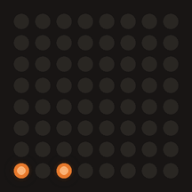 | `terminal` | Claude runs a **shell** command: `Bash` | A shell session scrolling up out of the bottom row. A command types out slowly on the input line with a caret blinking ahead of it, one or two faster output lines follow, and every finished line is pushed up into the history. Past commands stay marked by a pixel in the left column, a blank row separates one block from the next, and the prompt marker in the corner never goes out |
| 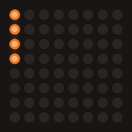 | `orbit` | Claude is **delegating** to subagents, or a turn ended while subagents still run | The same comet that `loading` uses, running clockwise around the border |
| 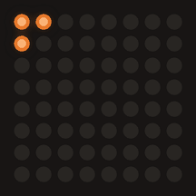 | `pointer` | Claude calls an **MCP** tool, `mcp__<server>__<tool>` | A three pixel L pointing to the upper left glides diagonally and then straight to a random spot. On arrival it either clicks, with a circular ripple spreading from the tip, or drags a rectangle out to a corner, or simply rests, then it sets off again |

Five extra animations are not assigned to anything by default. Pick one for any
activity on the [settings page](#settings-page), or send it as the `animation`
override of a `working` request:

| Picture | Animation | Shows |
|---------|-----------|-------|
|  | `tetris` | Blocks of one or two pixels a side fall and stack up, full rows flash and collapse, and the grid resets once the stack reaches the top. Quick and steady |
| 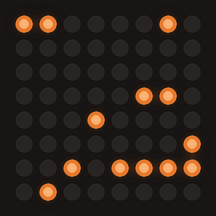 | `life` | Conway's Game of Life on a wrapping 8x8 grid, a couple of generations per second. It reseeds when everything dies, when the grid settles and after a while anyway |
| 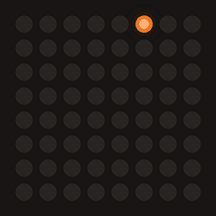 | `rain` | Matrix rain: every column runs its own falling streak, a head with a short trail, each at its own speed, so the columns drift out of step |
|  | `pipes` | The 3D pipes screensaver on 8x8. A pipe grows one pixel at a time, mostly straight, keeping a dark pixel to every pipe already laid, so two runs never go side by side and only diagonal corners touch. A dead end ends the run, the next pipe blinks once where it starts, and once nothing can start any more the matrix clears and the run begins again |
| 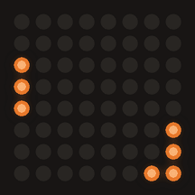 | `pong` | Pong on 8x8: a three pixel paddle in the first and the last column and a ball crossing between them. A paddle hesitates on 4 percent of its steps, so a rally runs around a dozen crossings before the ball gets through, the column flashes and the next ball is served |

The rhythm of each one, down to the millisecond, is in
[Working animations](technical.md#working-animations).

## Activities

Which animation plays follows the **activity** the session is working in. A
`working` request carries the activity, the board looks the animation up in the
`animations` setting, and each activity's animation is picked on the
[settings page](#settings-page). With the Claude Code hooks installed the
activity follows what Claude is doing, the full mapping is under
[Event mapping](reference.md#event-mapping):

| Activity | Default animation | Sent by the hooks for |
|----------|-------------------|-----------------------|
| `thinking` | `knight` | A submitted prompt, and every tool without an activity of its own |
| `reading` | `scan` | `Read`, `Grep`, `Glob`, `WebFetch`, `WebSearch` |
| `editing` | `code` | `Edit`, `Write`, `MultiEdit`, `NotebookEdit` |
| `shell` | `terminal` | `Bash` |
| `delegating` | `orbit` | Subagents, and a turn that ends while subagents still run |
| `mcp` | `pointer` | Every MCP tool, named `mcp__<server>__<tool>` |

`mcp` covers every MCP server alike, the hooks do not tell a browser server
from any other, so the pointer clicks for a documentation lookup as well as for
a browser step. `pong` is the alternative for a setup without GUI work.

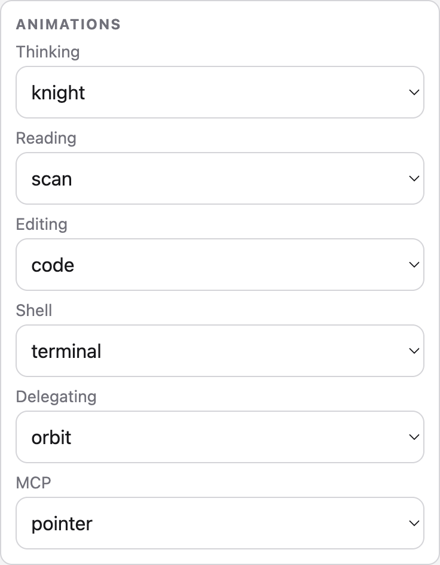

`thinking` is what a `working` request without an activity shows.

## The coin and the BOOT button

The touch pad is a 5 euro cent coin on a wire to GPIO4, the only control
needed day to day:

| Gesture | Does |
|---------|------|
| tap | Acts on the release: acknowledges `attention`, otherwise cycles the view `clock`, `normal`, `usage`, ignored while the `off` view is on |
| double tap | Takes back the view change of the tap before it, then turns the matrix off, or lights it again with the view it had before, also confirms the wake from deep sleep |
| hold | Released between 800 ms and 2 s, sets every session to `idle`. Keeping the contact past 2 s starts the [factory reset](#factory-reset) fill instead, which completes at 10 s |

The matrix answers an approaching finger with a dome growing in from the top
edge in three levels, drawn over whatever is showing, and a gesture that
changes the picture ripples into it instead of cutting over at once, see
[Hover dome and ripple](technical.md#hover-dome-and-ripple).

Any gesture instead just lights the screen again, and does nothing else, while
a timeout or the night window turned it off on its own, see
[the display cascade](technical.md#display-cascade).

The BOOT button on the board (GPIO0) acts on a press released under 1 s. A
release between 1 s and 2 s does nothing, from 2 s of contact the
[factory reset](#factory-reset) fill runs and 10 s erase the board. If the
displayed state is one that waits for a human (`attention`, `error`, `limit`,
`waiting` or `unread`), the button dismisses it, setting that session straight
to `idle` and resetting its watchdog. Otherwise it cycles the `thinking`
animation to the next of the eleven (`tetris` -> `life` -> `knight` -> `orbit`
-> `code` -> `rain` -> `scan` -> `pipes` -> `pointer` -> `pong` -> `terminal` ->
`tetris`), persists it, logs `punkt: button thinking=<name>`, and, if the
session on screen is `working` in the `thinking` activity without its own
override, restarts the animation with the new setting immediately.

The coin is read as a capacitive electrode, and how it tracks its baseline,
what it logs and how to tune its trigger are in [Touch](technical.md#touch).

strich has two coins with gestures of their own, see
[Two coins on strich](#two-coins-on-strich).

## Views and gauges

The state machine decides what a session wants to show, the view decides what
the matrix does with it:

| View | Shows |
|------|-------|
| `clock` | The digital clock, whatever the state |
| `normal` | The animation of the displayed state |
| `usage` | The 5 hour usage limit gauge. Without a named session the clock in `idle`, and every other state its own animation |
| `battery` | strich only: the estimated charge of the cell, see [Battery](#battery) |
| `off` | The matrix dark, whatever the state, a manual off that keeps the board and the sessions running |

The board boots in `clock`. The coin moves between the views, see
[The coin and the BOOT button](#the-coin-and-the-boot-button) and on strich
[Two coins on strich](#two-coins-on-strich), and `POST /view` or the settings
page set one directly. `attention`, `error`, `loading` and
`off` break through whatever view is set, and the complete rules are in
[Views](technical.md#views).

The **context gauge** is the bottom row: it fills left to right with how full
the context window is, under the calm states `waiting` and `unread`, and on
strich under `idle` in the split picture. Every other animation ignores it. The
**usage gauge** is the `usage` view: the share of the 5 hour limit fills the
whole matrix from the bottom row upward, on strich the right one, and the
gauge starts blinking and then pulsing as the limit gets close. Both
percentages arrive from the Claude Code status line on every render, so they
only move while Claude Code runs. When
nothing has arrived for a while the gauge disappears, the context after ten
minutes and the usage after an hour.


Without a command for the `clockTimeoutMin` minutes set under
[Settings](reference.md#settings), `normal` and `usage` fall back to the clock on their
own. Every `POST /state` except `off`, `idle` and `unread` pulls the view from `clock`,
`usage` or `battery` back to `normal`, so the next thing Claude does is seen
even when the board was resting on the clock. When the shown session turns
`idle`, `normal` returns to `clock` on its own, so a finished turn rests on the
clock. `unread` keeps the clock and only adds a small blinking marker pixel in
its top row, and a shown busy state that turns `unread` returns `normal` to
`clock` as well. Resting further dims the clock and then switches the screen off, see
[the display cascade](technical.md#display-cascade).

## Settings page

`http://punkt.local/` serves a single page, no external assets, usable on a
phone, the time and number inputs included, and it follows the system's light
or dark mode:

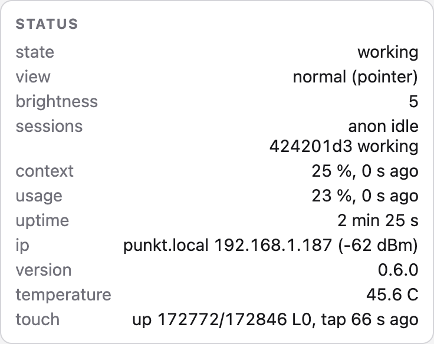

- **Status**: state, active view with the animation on the matrix and the off
  reason while the screen is off, the brightness ceiling in effect with a
  dimmed note while the resting cap applies, the sessions one per line as the
  first 8 characters of the id and the state (`anon` for the empty id, `none`
  when the table is empty), context and usage percentages with their age or
  `stale`, uptime (seconds, minutes, hours or days), the `<name>.local` host
  with its IP and RSSI, firmware version, chip temperature and the touch
  reading (`up`/`down`, raw/baseline, hover level `L0` to `L3`, last gesture),
  refreshed every 5 s.
- **Brightness**: the 0-15 brightness slider and the 0-15 dimmed brightness
  slider, used both at night by [auto dim](#auto-dim) and by the resting
  clock; the follow-the-sun checkbox with a note showing the sun position
  coordinates of the chosen city; and the minutes the clock rests before the
  dimmed brightness applies, `0` never dims, see
  [the display cascade](technical.md#display-cascade).
- **Location and clock**: a city picked from a list grouped by region,
  `Europe/Berlin` by default, and a button that takes the city from the
  browser's timezone, that of the phone or laptop showing the page. The city
  sets the clock's timezone and the sun position for
  [auto dim](#auto-dim) in one go. The board has no location of its own, and a
  plain `http://` page cannot ask the browser for one, so the city is the only
  source. On strich the card adds the full clock face and the split clock
  style, see [Clock faces](#clock-faces) and [Split clock](#split-clock).
- **Screen off**: the minutes after which the view falls back to the clock and
  a further minutes after which the screen switches off, `0` disables either
  stage; off at night with its from and to time and the deep sleep checkbox,
  see [the display cascade](technical.md#display-cascade) and
  [Night sleep](#night-sleep). On strich the minutes on battery before the
  [battery sleep](technical.md#battery-sleep), `0` never sleeps.
- **Animations**: six animation dropdowns, one per working activity
  (`thinking`, `reading`, `editing`, `shell`, `delegating`, `mcp`), each
  offering `tetris`, `life`, `knight`, `orbit`, `code`, `rain`, `scan`,
  `pipes`, `pointer`, `pong` and `terminal`.
- **Touch**: the 5-250 percent trigger slider, the 0-50 percent hover slider
  that sets where the dome starts, and the touch debug stream.
- **Try it**: a dropdown listing every animation the board owns with a button
  that plays it for 10 s, useful to look at a picture without sending a
  request by hand.
- **Device**: power save, the board name, plus restart and forget Wi-Fi, the
  last two behind a confirmation dialog.

A control that only applies while a switch above it is on is greyed out while
that switch is off: the sun position note under follow the sun, and the sleep
time, wake time and deep sleep checkbox under off at night.

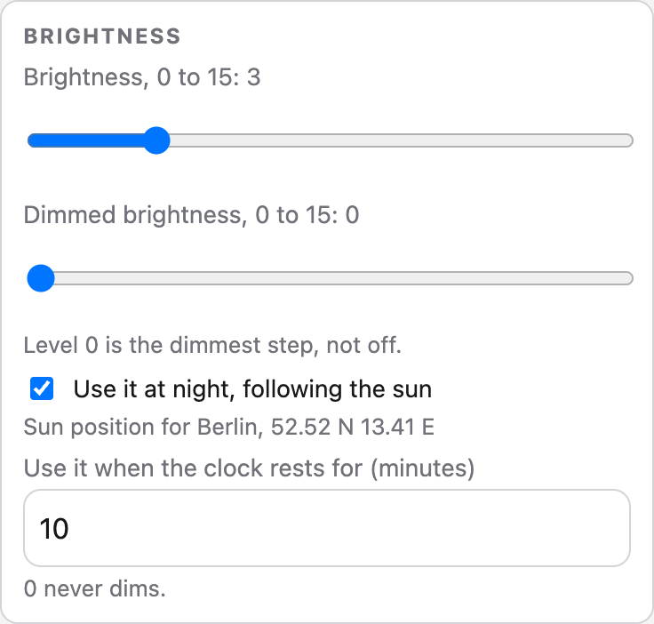

There is no save button: every setting is posted on its own as soon as it
changes, the sliders live and debounced by 100 ms, the other controls when
they lose focus or are toggled. After each post the form reloads the settings
from the board, so a clamped or rejected value snaps back to what was stored.

A status line under the form reports the result of each request.

## Sessions

Up to 8 Claude Code sessions can share the matrix at once. The matrix shows the
session in the most urgent state, so an `attention` in one window is never
hidden by another window that is still working, and a request from a ninth
session is dropped. The priority order, and the watchdog that cleans up after a
session that stops reporting, are in
[Sessions and the watchdog](technical.md#sessions-and-the-watchdog).

## Night sleep

With the `nightOff` setting on (off by default) the board puts the screen to
sleep for a window of the day, from `sleepAt` (`22:00` by default) to `wakeAt`
(`07:00` by default), wrapping past midnight if needed. Inside the window the
screen switches off 10 minutes after the last activity, whether or not a
Claude Code session is open, and a Claude hook or a touch lights it again,
returning to the picture it showed before. The window closes itself at
`wakeAt`.

With `nightSleep` on as well (off by default) the board goes further at night:
deep sleep with matrix, LED and Wi-Fi dark, rather than the screen simply off
with the radio still up. The board only goes down this way while no named
Claude Code session is in the table and no button press or touch gesture
happened in the last 10 minutes, and the deep sleep timer always wakes it at
`wakeAt` on top of the touch wake. A session that is still open at `sleepAt`
keeps the board from the deep sleep, and it follows ten minutes after the
session signs off.

```sh
make set K=nightOff V=true
make set K=sleepAt V=22:00
make set K=wakeAt V=07:00
make set K=nightSleep V=true
```

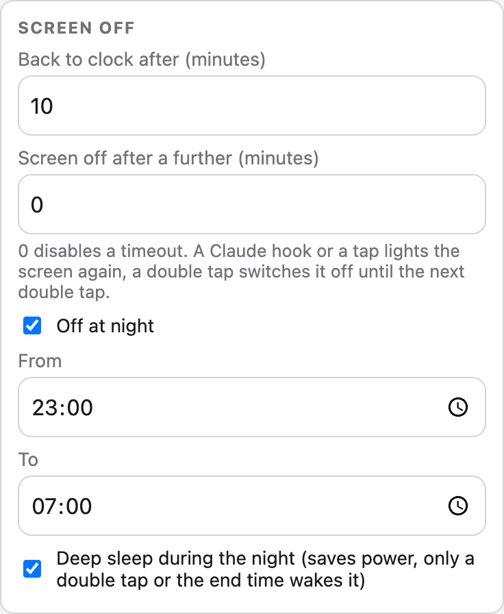

Waking the deep sleep takes **two taps**. The first touch wakes the chip, that
part is hardware and cannot be filtered, but the firmware then waits
**2 seconds** for a second tap before it brings anything up. Without that tap
it goes straight back into deep sleep, so a sleeve brushing the coin costs
about two seconds with the matrix dark and nothing else. A timer wake needs no
tap, it boots straight through at `wakeAt`. Nothing else wakes the board from
deep sleep: not the BOOT button, and not a Claude Code session that starts
while it sleeps. The details of the window, the sleep and the wake are in
[Night sleep](technical.md#night-sleep). On strich the left coin wakes it, and
the separate sleep on battery wakes on a single touch, see
[Battery](#battery).

A double tap while the screen is on enters the `off` view instead, a separate
manual off that leaves everything but the matrix running and stays until the
next double tap, unlike the screen switching itself off inside the window.

## Auto dim

With the `autoDim` setting on (off by default) the brightness ceiling follows
the sun: the board computes the sun's elevation for the coordinates of its
`city` from the date and the time, and slides the ceiling between the
`brightness` slider value by day and `nightBrightness` (`2` by default) at
night. The night level applies while the sun is 6 degrees or more below the
horizon, the end of civil twilight, and the day level once it is 10 degrees or
more above it. In between the matrix glides through the steps, so it gets
progressively dimmer through dusk and brighter through dawn. At 52 N the glide
takes roughly 1.5 to 2 hours each evening and morning, longer in winter and
shorter in summer. The slider keeps setting the day level, the curve keeps
applying on top of it.

The clock face resting on its own for `dimTimeoutMin` minutes caps the ceiling
at `nightBrightness` too, whichever of the sun's level and that cap is lower
applies, see [the display cascade](technical.md#display-cascade).

```sh
make set K=city V=Europe/Berlin
make set K=nightBrightness V=2
make set K=autoDim V=true
```


The board never knows where it is: the city is picked by hand on the settings
page, or taken from the timezone of the phone or laptop showing the page with
one button. Browser geolocation is not available to a plain `http://` page
such as `http://punkt.local`, which is why there is no locate-me button.

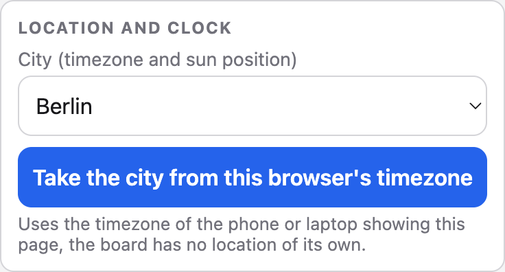

The coordinates are those of the city centre, which lands within a degree or
two of the board. One degree moves the curve by about 4 minutes, invisible on
16 levels. Level `0` is the dimmest step of the matrix, still faintly lit, not
off. Everything is computed on the board, there is no sunrise service to call,
so nothing new leaves the network. The level is recomputed every 30 s and each
change is logged as `punkt: auto dim level=5 sun=3.2deg`. Auto dim and the
[night window](#night-sleep) are independent, one dims the matrix, the other
switches the screen off. The mapping and the maths are in
[Auto dim](technical.md#auto-dim).

## Several boards and Claude directories

Each Claude Code directory talks to the boards its hooks are pinned to. Two boards on one
network need two names, and two Claude directories need two installs:

1. Give the second board its own name, for example `punkt-work`. It restarts
   and answers as `punkt-work.local`, with `punkt-work-setup` as its portal.
   The settings page does the same without the restart.
2. Install the hooks into the Claude directory that should drive it, pinned
   to that name:

```sh
make name N=punkt-work HOST=<address of the second board>
make hooks-install HOST=punkt-work.local CLAUDE_HOME=$HOME/.claude-work
```

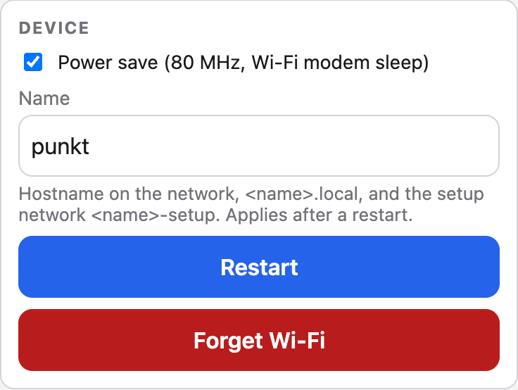

`HOST` writes `PUNKT_HOST=punkt-work.local` in front of every installed hook
and status line command, so that directory posts to that board only.
`CLAUDE_HOME` selects the directory; without it the installer uses
`CLAUDE_CONFIG_DIR` when the shell has it set, which is the variable Claude
Code itself reads for a second directory, and `~/.claude` otherwise. Write the
directory as `$HOME/...` rather than `~/...`, zsh does not expand a tilde after
the `=` of a make variable. The board side needs nothing else: a board serves
any number of Claude directories. The
other targets take the same `HOST`, so `make ota HOST=punkt-work.local` updates
the second board.

A directory can post to several boards at once when `HOST` is a comma-separated
list, for example a punkt at the office and a strich at home. Every hook then
goes to each listed board, one that is unreachable is skipped quietly:

```sh
make hooks-install HOST=punkt.local,strich.local
make hooks-install HOST=punkt.local,strich.local CLAUDE_HOME=$HOME/.claude-work
```

## Factory reset

Hold the BOOT button or the coin, on strich both coins together, for
**10 seconds**. After **2 seconds** the matrix starts filling from the bottom
row upward, reported as the `reset` animation, and releasing before it is full
cancels the fill and leaves the picture from before untouched. Once it is full the settings and the stored
Wi-Fi credentials are erased and the board restarts into the `<name>-setup`
portal, `punkt-setup` or `strich-setup` by default.

A second path erases the Wi-Fi credentials without the button: power cycle the
board **three times within 10 seconds** of each boot. Only a power cycle or the
RESET button counts, a flash, a serial monitor open, a crash, a brownout or a
wake from deep sleep does not. This path keeps the settings, only the button
hold erases them.

To erase the credentials without touching the board, use `make forget-wifi`,
`POST /forget-wifi` or the **Forget Wi-Fi** button on the settings page. The
log lines, the boot counter and the rest of the internals are in
[Factory reset](technical.md#factory-reset).

## Troubleshooting

- **The board does not show up as a serial port**, no `/dev/cu.usbmodem*` on
  macOS or `/dev/ttyACM*` on Linux: check the cable first, a charge-only cable
  carries no data. Otherwise the board is not in a state where its USB shows
  up: hold **BOOT**, tap **RESET** or plug it in, release **BOOT**, as
  described under [Build and flash](../README.md#3-build-and-flash). On Linux
  also check the serial port permissions, see
  [Platforms](../README.md#linux).
- **`make flash` or `make monitor` picks the wrong port**, on macOS often the
  Bluetooth one: pass the board's port, `make flash PORT=/dev/cu.usbmodem1101`
  or `make monitor PORT=/dev/ttyACM0`.
- **Upload fails partway through the app image** with errors such as
  `Packet content transfer stopped`, `The chip stopped responding` or
  `The format of the received message is invalid`, at a different point every
  time: another process is reading the serial port while esptool talks to the
  ROM, typically a serial monitor or a host tool that grabs the first USB
  serial port it finds. Find it with `lsof /dev/cu.usbmodem*` or
  `lsof /dev/ttyACM*`, stop it, flash, then start it again.
- **Upload keeps failing with no other process on the port**, or a flash read
  comes back short: the host's USB serial driver is dropping bytes on the
  ESP32-S3 USB-Serial/JTAG port. The same cable carries a JTAG interface that
  OpenOCD drives through libusb without that driver, `make flash-jtag`. It
  writes and verifies every image and takes about a minute, then resets the
  chip through the serial port, since OpenOCD leaves the CPU halted after
  programming and the board would otherwise sit dark until a tap on
  **RESET**. `PORT=` picks the port for that reset, OpenOCD itself needs no
  serial port. The `Unexpected OCD_ID` lines concern the second core's probe
  and are harmless. A failed serial flash leaves the app slot erased and the
  board in a boot loop, so OTA is not an alternative at that point.
- **Matrix stays lit or shows a stale frame while the ESP is in download
  mode**: normal. The HT16K33 keeps its display RAM until it loses power and
  the firmware clears it on the next boot.
- **The matrix stays dark and the serial log repeats
  `punkt: matrix not found at 0x70 on SDA=8 SCL=9, retrying`**: the matrix is
  missing or miswired, check the [wiring](hardware.md#wiring).
- **`curl http://punkt.local/...` hangs on "Resolving" while `ping punkt.local`
  works**: curl waits for an IPv6 mDNS answer the board never sends. Pass `-4`
  to force IPv4, as every example in these docs and the Makefile does.
- **`punkt.local` does not resolve, or the board is unreachable even by IP**:
  check for an active VPN. Most VPN clients block multicast DNS and route LAN
  traffic through the tunnel. Disable the VPN or exclude the local network,
  the board itself is fine: a board that lost its own link shows the
  [`wifi-lost` symbol](technical.md#link-and-update-pictures) on the matrix.
  On Linux `.local` names also need avahi, see
  [Platforms](../README.md#linux), or pass `HOST=<ip>`. The Claude Code hooks
  use `-m 5` so a blocked board only costs five seconds per call.
- **`make ota` fails with `Host punkt.local Not Found`**: espota cannot
  resolve `.local` names on its own. `make ota` resolves the name first, when
  that fails too pass the address, `make ota HOST=192.168.1.10`.

`make doctor` checks the tools, the serial port, the board and the installed
hooks in one go and names what is missing.

## Known limitations

- **Plugging USB into strich can cause a watchdog reset**, reported as
  `task-wdt` in the `reset` field of `GET /state`. The board comes back up on
  its own.

These concern strich and its battery, which feeds VBUS through a diode once USB
is gone:

- **USB-C chargers and some computers' own USB-C ports, a Mac's among them,
  refuse the board** while the battery is attached, since they find voltage on
  VBUS already. Charge strich from a USB-A port, a USB-A charger or a USB hub.
  To use it on a Mac through a dock or a hub, connect the dock to the Mac first
  and strich to the dock afterwards.
- **The matrices run noticeably dimmer on battery.** They hang on the 5V pad,
  which then carries the cell voltage less the diode drop of 0.7 to 0.85 V,
  about 3.3 V with a full cell, instead of 5 V.
- **The charge is a rough estimate**, read from VBUS and mapped along a curve
  measured on one cell, see [Battery](technical.md#battery).
